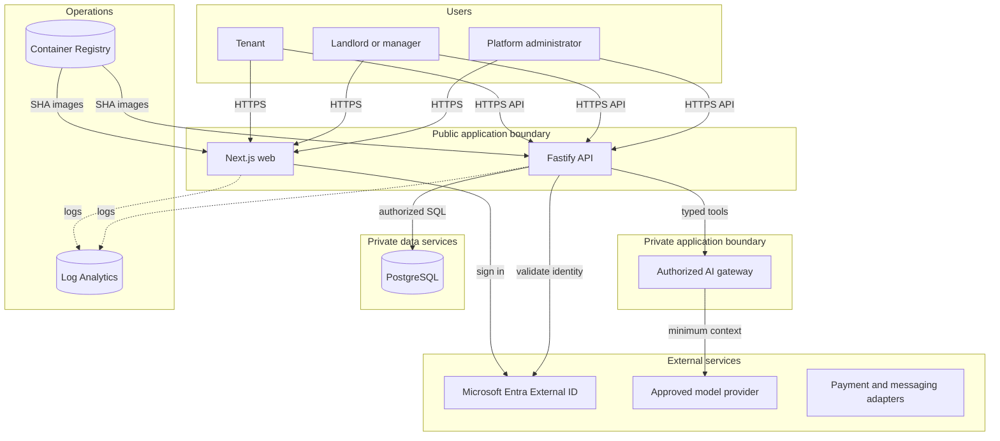
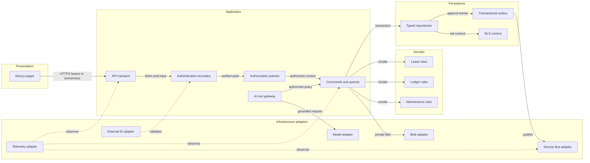

# Infrastructure

KEYFORTA pilot infrastructure targets Azure Container Apps in South Africa
North. The reviewed Bicep creates one lean `dev` stamp. Test, production, and
unused managed services are deferred until pilot evidence justifies them.

## Entry points

| File                          | Scope                                                             |
| ----------------------------- | ----------------------------------------------------------------- |
| `bicep/foundation.bicep`      | Resource group stamp, network, data, messaging, and observability |
| `bicep/migration-job.bicep`   | Private, manually triggered database migration job                |
| `bicep/seed-job.bicep`        | Dormant, manually triggered synthetic data job for `dev` only     |
| `bicep/apps.bicep`            | Public web and API, managed identities, and ACR access            |
| `bicep/database-access.bicep` | PostgreSQL Entra administrators and narrow DBA workstation access |
| `bicep/external-identity.bicep` | External ID tenant and dedicated Azure resource group           |

Foundation parameter files live in `config/`. Tenant IDs and application
registration values remain GitHub environment variables and are supplied at
deployment time. Templates compile independently before `what-if` is allowed.
The bootstrap administrator creates each environment resource group before the
resource-group-scoped foundation deployment runs.

## Company DEVELOPMENT preparation — isolated preview and plan-bound apply

### Current policy — approved 2026-10-26, prepared code only

Issue [#159](https://github.com/keyforta/keyforta-property/issues/159): the owner
said **“change those requirements... remove them”**, then **“remove those 2
blockers”**. This removes only manual freeze/UI-observation evidence blocking
completion audit and the separate manually reviewed exact-SHA preview/digest
handoff blocking apply. It does not accept all of ADR-016 or authorize execution,
merge, settings/RBAC/federation changes, uploads, or resource writes.

New producers use evidence/input/inventory **3**, apply checkpoint **3**,
completion intent/receipt **2**, completion/plan source closure **5**, and
inspection closure **6**. Legacy evidence/checkpoint 2, intent/receipt 1 and source
closures 1 (historical implicit), 3 and inspection 4 retain their original strict
contracts, including old freeze/UI fields and completed successful standalone
preview checks. Unknown versions fail closed. New contracts reject obsolete
`changeFreeze`, `freezeReference`, and `manualUi` fields instead of silently
consuming them. Historical archive bytes and workflow blob pins are unchanged.

**Execution:** one explicit owner `workflow_dispatch` of
`company-development-foundation-apply.yml` runs
`preview_guard → plan → apply_guard → apply`. The plan runs in `company-dev`
with the existing preview federation; only apply uses the distinct
`company-dev-apply` writer. Both share `company-dev-foundation` concurrency with
cancel-in-progress false. The standalone preview remains **preview only**; its
success never dispatches or authorizes an apply. No `actions: write` is added.

There are no manual `plan_run_*`, `plan_artifact_id`, `reviewed_*` or
`change_freeze` dispatch inputs. The successful plan upload exports immutable
artifact ID and archive digest through fixed `needs` job outputs.
`ordered-plan-apply-v1` binds evidenceVersion, SHA, stage/mode, native run/attempt,
producer job ID, artifact ID, archive SHA256 and six recomputed source/template/
parameters/what-if/inventory/evidence digests. These are **execution bindings,
not human-reviewed hashes**. The overall run must be **in progress**, while its
unique current-attempt plan job and upload step must be completed/successful.
No optional-success exception is added to legacy standalone plan validation.

Before writer sign-in and again immediately before ARM PUT, the consumer
reauthenticates native owner/triggering actor, workflow/ref/SHA/repository/main,
current-attempt jobs, artifact metadata and unique bounded listing, expiry,
size/digest and upload/job time bounds. It downloads **by artifact ID**, hashes
and bounded-parses the **same archive bytes**, and cross-binds all payloads to
current committed source. An apply-only rerun cannot consume a previous-attempt
plan. Latest exact-SHA push CI/security/DAST (including a newer pending/failed
run), live environment drift, caller separation, approved network inputs,
stage/scope inventory and fresh what-if remain fail-closed.

**Assurance limit/risk:** GitHub artifact metadata does not cryptographically
identify a producer job or attempt. This route relies on the exact approved
workflow's sole matching producer, native attempt job, fixed successful `needs`,
upload outputs and temporal metadata correlations. There is no human plan
review pause. Manual UI evidence is no longer required. If the API exposes
`can_admins_bypass: true`, stop; an absent field is recorded as **unobservable**,
not false or a claim that bypass is off. Actual environment identities, protected
branches, readable actual rule inventories and live snapshot revalidation remain.

**Still blocking, not removed:** actual human approval of the complete
`frozenSnapshotSha256`; `inspectionReference`; authenticated original archive/
predecessor; `ownerAuthorizationReference` and `authorizedAt` (not future,
no older than one hour, before dispatch); observer isolation; narrow effective
permissions; security/functional handoff and proven writer revocation before
continuation. A comment URL is context, not authenticated approval. Inspection
evidence is never a completion receipt, checkpoint or deployment authority.
The audit access plan is **APPLIED**; this change does not reopen or alter it.

No live audit or deployment was run for this change. Original run
`40262729364/1` retains `completed:false`; all archives remain immutable.
Inspection `40379515709`, artifact `12676608644`, snapshot
`23400cec3380e068222ee8e6bce389d3fbe7f470dfe767c22480f8e17deef8ed`
is observation only, not snapshot approval or a receipt. Known three Modify/five
Delete-property predictions have no override; strict NoChange recovery,
destructive stops and no automatic retry of uncertain PUT outcomes remain.
Defender is disabled, writer NOT REVOKED/PIM unknown; no full-stack readiness.

**Operations/cost/rollback:** unchanged $108.35/month estimate before tax and
$120 ceiling, not a guarantee; no resource/Bicep/service/library/identity change.
Telemetry, seven-day backup/soft-delete, restore-test requirements, SLOs/error
budgets and existing incident/security/backup runbooks are unchanged and are not
claimed operationally verified by these tests. On failure preserve evidence and
inspect exact operations/inventory; never auto-delete/retry or recover
destructively. Roll back by an authorized code revert restoring the old workflow
profile and obtain a fresh exact-source authorized operation/plan. Do not reuse
old plan artifacts or mutate archived evidence/settings to fit reverted code.

**Local validation:** use a disposable PostgreSQL cluster/database containing
synthetic data only, with `TEST_DATABASE_URL` pointing to that local instance;
run `pnpm verify`. Do not reuse production or a shared operational database.
No Bicep payload changes are included here, so no resource compilation/deployment
is required for this policy-only executable change.

### Historical v2 staged implementation — superseded only as noted above

The authoritative [staged proposal in ADR-016](../docs/adr/ADR-016-company-development-private-foundation.md#proposed-staged-company-foundation-contract)
remains a **Proposed ADR awaiting external acceptance**, but the
[Product Owner explicitly approved staged local implementation](https://github.com/keyforta/keyforta-property/issues/159#issuecomment-6402966949).
The two reserved decisions are specifically approved: temporary **empty/unused**
Storage before verified Defender, and **human removal of all bootstrap workflow
writer rights, including inherited/equivalent authority, before grants/security
handoff**. Continuation must never regain UAMI/ACR/Storage writes.
Follow ADR-016: cmbuyamba owns Azure technical decisions; no second Azure technical review.
Explicit human merge/deploy authorization remains required; independent review
is no longer an activation prerequisite (see ADR-016's subsequent decision).
Platform must prove narrow continuation/ACA permissions; sufficiency is unproven.
Historical run `40223406509` attempt `2` / artifact `12610233452` was reviewed;
see ADR evidence/expiry. It is **historical only**, never a staged execution input.
No activation, Azure writes, configuration changes or workflow dispatch occurs here.
Unchanged: $120/month before tax, $108.35 estimate, no extra services or cost guarantee.

**Implemented routes:** `stage=bootstrap|continuation`,
`mode=initial|reviewed-reentry`, `evidence_version=2`. Protected continuation
requires actual readable security/permissions plus the owner-confirmed functional
record under the [specific subsequent approval](https://github.com/keyforta/keyforta-property/issues/159#issuecomment-6403538260).
That approval covers the **code/test contract only**, not actual execution or
upload. Internal topology remains **UNVERIFIED**, never inferred from names,
mutable tags or absence of errors. The authoritative acceptance map is in ADR-016.

Bootstrap creates exactly three UAMIs, ACR, Storage, Blob service and private
container (seven writes plus deployment records). No Network, PG, ACA, logs,
role assignments, Defender/scanner, applications, jobs or data. Source/default
shared-module behavior remains unchanged, including full Defender 100 GB
on-upload/index settings, authentication and retention. Neither company
template stage creates grants or Defender. Bootstrap is **NOT foundation-ready**:
no app attachment, uploads, customer data, migrations or cutover.

Current routes retain the two native protected environments, separate scoped
preview/apply federation, manual/main-only entry, immutable checkout, same
concurrency, latest exact-SHA CI/security/DAST and supported GitHub protection
snapshot checks. The user explicitly approved removing independent environment
review: neither environment needs required reviewers, prevent-self-review or
initiator/rerun-actor separation. The authorized operator inspects protected
branches and **admin bypass disabled in the live UI**, and retains exact
SHA/run/attempt/environment ID/snapshot hash and reviewed stage/inventory with
explicit human merge/deploy authorization. No native approval comment is required.
Code still binds actual rule metadata (including any optional reviewer rules)
and rejects changes before OIDC; it does not change GitHub settings, parse
comments, invent issuer attestations or treat JSON as security approval.

Preview additionally requires explicit approved CIDRs/network reference and a
`change_freeze` repository issue/PR/comment reference. That reference binds
operator review context; it does not authenticate or prove a freeze. Initial
bootstrap requires an existing empty company RG **and empty ARM deployment
history**, and already registered ManagedIdentity/ContainerRegistry/Storage.
No registration/RG/identity/federation/RBAC setup is performed by the helper.
The authorized operator must review stage-scoped effective preview/apply permissions
and external freeze ownership. Bootstrap writers must have no security/grant
authority; do not use Owner/Contributor or subscription workload writers.
Continuation rechecks original bootstrap apply-caller permissions at bootstrap
and readable security scopes, rejecting surviving writer/data authority. RG
permission reads check the narrow stage-operation allowlist. These are readable
current-caller checks, not proof of equivalent/transitive/group/PIM authority;
cmbuyamba's genuine owner review under the native gate remains mandatory.

The preview artifact is exactly seven regular JSON files: existing six
(`evidence`, `inputs`, `parameters`, `review-context`, `template`, `what-if`)
plus `inventory.json`. Its name is
`company-dev-foundation-STAGE-MODE-v2-plan-SHA-RUNID-ATTEMPT`.
Version/stage/mode, actual destination checks, reviewed baseline/expected IDs,
predecessor/security handoff (null only for initial bootstrap), freeze reference, full
source dependencies and hashes are bound. Source manifests cover the three
Bicep files, both route helpers plus their shared read-only state helper, both
workflows and existing parser gate (nine paths total), hashing raw
Git blobs at the exact SHA and rejecting targeted worktree drift.
Compiled name expressions are reviewed locally; actual provider what-if must
resolve **exactly** the seven expected IDs, not merely seven allowed types.

Apply inputs retain run/attempt/artifact ID and reviewed source/template/
parameter/what-if hashes, adding stage/mode/version and reviewed **inventory**
and **evidence-envelope** SHA256. The envelope binds input/context/dependency
hashes as well; artifact identity/provenance comes from actual GitHub metadata
after upload, not a fabricated pre-upload artifact ID. Legacy full-plan
six-file/v1 artifacts cannot apply. Before its one incremental PUT, apply
rechecks latest quality, actual identity/tenant/sub/RG/region, stage-specific
inventory/history/permissions/security, then fresh canonical what-if against the
reviewed in-memory template/parameters. It repeats actual checks and quality/source
checks before submission; initial bootstrap also repeats emptiness.
No mutable parameter file is consumed by ARM.

After ARM success, read-only `az deployment operation group list` recursively
reads the actual known nested deployments and checks all seven targets.
`az resource list` plus typed `az resource show --ids … --api-version …` reads
the actual UAMI resource/tenant/principal/client IDs and registry/Storage/Blob
properties. Fail closed on missing visibility, duplicate identities, wrong
destination, extra/missing resources or security-property drift. The execution
artifact includes `bootstrap-state.json`, `checkpoint.json`, submission hash and ARM result; it
explicitly records **security handoff not verified**. This is not effective-RBAC,
scanner/backend or readiness evidence. No app/data access is attempted.

ARM may also record successful output-reference `Read` operations: the root
reads `foundation-keyforta-cdev`, foundation reads `stamp-keyforta-cdev`, and
stamp reads only the exact bootstrap ACR and API/migration UAMIs. These
context-bound ID/type checks grant **no Create provenance** and do not recurse;
all seven exact resource Creates remain required. Missing/foreign/unexpected
Read targets, failed/incomplete operations and targeted output evaluation stop.

**Recorded postflight incident (2026-10-26 UTC):** apply run `40262729364`,
attempt 1, SHA `6216a0c95b49f522fecf1c28d8ba3405f1a93a43`, failed workflow
verification because the original verifier rejected ARM `Read`. The root
`companydev-bootstrap-6216a0c95b49` and both nested deployments succeeded;
read-only execution evidence records all seven resources and all 17 successful
operations, including the five Reads above. Apply artifact `12625346104`
retains `checkpoint.json` with **completed=false**; `bootstrap-state.json` was
not generated. ARM success is not workflow/checkpoint completion. Preserve
the original artifact, caller, resource IDs, identity bindings and state; never
manufacture completion or overwrite the failed-run evidence. See
[the recorded outcome](https://github.com/keyforta/keyforta-property/issues/159#issuecomment-6407407563).
This code correction does not reconcile that checkpoint or authorize another
operation. Future recovery requires merged corrected code and a fresh reviewed
reentry from actual inventory, the failed workflow/immutable artifact and the
successful ARM outcome, with source/plan/provenance and original-caller checks
still enforced. If those checks cannot establish safe recovery, stop for human
review; never fall back to initial retry. No Blob/data operations, permissions
expansion or new costs are part of this correction; existing handoff, cost,
telemetry, backup/restore and readiness constraints remain unchanged. Code
rollback is a human-reviewed revert, never resource deletion or replay.

Failed/canceled/unknown ARM outcomes and polling timeout stop and retain evidence.
Inspect the **existing deployment** before any later write; never retry, clean
up, recreate or delete automatically. Partial and completed inventories both
block **initial bootstrap**; the separately reviewed recovery route below is
required. Exact completed source/template/parameters/resources, terminal ARM
inspection and fresh NoChange produce a verified **no ARM PUT**. Withhold
dispatch/activation while external readiness is incomplete; no variables were disabled
or enabled by this implementation.

#### Human handoff evidence — readable machine checks and native owner review

After bootstrap, the human must first remove workflow bootstrap writer rights
and prove no inherited/equivalent access remains. The following are supported
read operations for inspection, not a machine-complete revocation proof:

- `az account show --subscription 891e5e6e-8ae3-4455-9184-8d7606223d91`;
  verify tenant `8019a048-e7d6-48e8-984a-b902f641a21b`.
- `az role assignment list --scope <exact-resource-or-RG-ID> --include-inherited --subscription 891e5e6e-8ae3-4455-9184-8d7606223d91`.
  Inspect actual role definitions, conditions, scope and effective context;
  this listing alone does not establish group/PIM/deny/equivalent authority.
- Caller-context `az rest --method get --url "https://management.azure.com<exact-scope-starting-with-slash>/providers/Microsoft.Authorization/permissions?api-version=2022-04-01" --subscription 891e5e6e-8ae3-4455-9184-8d7606223d91`.
  Use the actual caller and normalized scope.
  This API reports that caller's permissions, not another principal's complete
  effective rights; a successful read/activation flag is not revocation proof.

Only the human may then grant the three exact-scope AcrPull roles and API
container Blob Data Contributor described in ADR-016, using actual ServicePrincipal
object IDs and existing deterministic Bicep `guid(scopeResourceId,
uamiResourceId, fullRoleDefinitionResourceId)` assignment names.

**Implemented read/command preparation, not grant execution or handoff approval:**
the manual operator may use the following only under separately authorized
operator-read context; it has not been executed against Azure in this work:

```sh
node scripts/infra/company-development-apply.mjs human-grant-plan \
  --deployment companydev-bootstrap-<reviewed-sha-prefix> \
  --predecessor /path/to/reviewed/bootstrap-state.json \
  --predecessor-sha256 <reviewed-file-sha256>
```

This command rejects GitHub Actions and service-principal contexts. It checks
the fixed actual account tenant/subscription, re-reads bootstrap deployment
operations/resources, compares actual UAMI resource/principal/client IDs with
the predecessor, then reads `az role assignment list --scope … --include-inherited`
for the exact registry and container. It prints **argv arrays**, never
executes `role assignment create`. Names use documented ARM `guid()` UUIDv5
semantics with full role-definition resource IDs. Exact existing tuples produce
no command; only missing tuples produce commands. Wrong IDs/principals/scopes/
roles, conditions, conflicting deterministic names, visible inherited UAMI
privileges and unexplained direct assignments at either destination stop.
The tuple checker also rejects caller-updated expected tuples that broaden
the approved policy. Nothing automatically changes/removes existing grants.

Scoped assignment reads retain `--include-inherited` and must not use `--all`
(Azure CLI rejects that combination). They return assignments at the scope and
its ancestors, **not descendants**. Partial-bootstrap recovery therefore also
queries the actual `tenant-applications` container independently when it exists;
any container handoff grant blocks before preview/submission. Missing inherited
or container-role visibility remains a stop, never a pass.

The output and predecessor hash are review context/byte binding, **not**
authenticated predecessor provenance, owner approval, complete inherited/
transitive/PIM privilege proof or bootstrap-writer revocation. Other principals'
inherited roles still need human assessment; two successful listings do not
prove exhaustive effective access. Protected continuation binds actual GitHub
checkpoint provenance separately and re-reads actual settings/identities/grants/
caller permissions. The authorized operator verifies genuine owner-authored evidence
and equivalent/transitive/PIM removal; there is no self-authored approval boolean.
Do not execute the emitted commands before the owner-approved writer-removal
condition and actual operator authority have been established. Do not grant
from client IDs or guessed GUIDs.

Future **human-only action preparation**, not execution authority: after reviewing
actual direct/inherited role definitions and effective contexts, remove each
identified bootstrap writer assignment using its actual assignment resource ID:

```sh
az role assignment delete --ids "<reviewed-actual-bootstrap-writer-assignment-id>" \
  --subscription 891e5e6e-8ae3-4455-9184-8d7606223d91
```

This is not a bulk cleanup or sufficient proof: inherited/group/PIM/equivalent
rights require owner-specific removal/verification, and continuation must not
regain bootstrap/security writes. Re-read caller permissions and owner evidence
before granting. Only the human executes separately authorized argv from
`human-grant-plan`; neither workflow can grant.

Defender is a separate human operation requiring reviewed subscription
datascanners read/write, Event Grid and role-management capabilities. Enabled
100 GB on-upload/index/no-exclusion settings, actual scanner identity and Storage
Blob Data **Owner** beyond those four grants are read. Any explicitly reviewed
service-created Event Grid system topic is read at its actual ID and checked for
its readable Storage source/provisioning state, without inferring internal mapping.
Missing visibility/unknown effective access or minimum ACA permissions blocks
continuation. Native human gates remain authoritative within their actual
review contract, not substitutes for missing readable data.

The existing-design settings action, after **separate human execution approval**
and operator-permission review, is this explicit REST PUT. Replace the placeholder
only with the exact actual Storage ID read from the fixed company destination:

```sh
az rest --method put \
  --url "https://management.azure.com<verified-actual-storage-id>/providers/Microsoft.Security/defenderForStorageSettings/current?api-version=2025-06-01" \
  --body '{"properties":{"isEnabled":true,"overrideSubscriptionLevelSettings":true,"sensitiveDataDiscovery":{"isEnabled":false},"malwareScanning":{"onUpload":{"isEnabled":true,"capGBPerMonth":100},"blobScanResultsOptions":"blobIndexTags"}}}' \
  --subscription 891e5e6e-8ae3-4455-9184-8d7606223d91
```

No command above was executed here. Re-read actual settings/scanner/service grants
and inventory; the PUT response or missing `operationStatus` alone is not healthy
backend proof. The owner-confirmed functional record below is additionally required.
Never create a guessed scanner/backend topic/Data Owner assignment in a workflow.

**Resolved semantic, with explicit limits:** the documented Defender settings read schema
`2025-06-01` exposes configuration/failure information, not successful backend
provisioning or storage-to-scanner linkage. The documented data scanner schema
`2026-08-01` is identity-only; it exposes no Storage/Event Grid relationship or
provisioning-state property. The optional scan-results Event Grid topic must
not be mistaken for the service-managed backend. The specific approval above
replaces that unobservable requirement with an **owner-confirmed harmless
functional test alongside actual readable configuration/identity/grant checks**.
It does not claim hidden internal linkage. Missing readable visibility still fails.

After **separate future execution authorization**, cmbuyamba manually follows
[Microsoft's test procedure](https://learn.microsoft.com/en-us/azure/defender-for-cloud/defender-for-storage-test)
and observes “Malware scanning scan result” and “Malware scanning scan time”.
No helper/workflow uploads, reads, deletes or modifies blobs/tags. Use a harmless
1–65536-byte `synthetic-<UUID>.txt`, not EICAR or an endpoint exclusion. Record
exact Storage/container IDs, blob version or ETag, content SHA256/length, ordered
strict UTC enablement/test-start/upload/scan/owner-observation times and result
`No threats found`. Test start and owner observation must be within 24 hours
at both preview and apply; the actual current readable security snapshot hash
must match. Missing/failed/stale/mismatched correlation stops continuation.
The 24-hour/64-KiB bounds are evidence limits, not Azure service guarantees.

[Index tags are mutable and not tamper-resistant](https://learn.microsoft.com/en-us/azure/defender-for-cloud/introduction-malware-scanning#blob-index-tags).
They MUST NOT be the sole security control or automated foundation-ready/
data-admission signal. The owner confirms the genuine actual result; the
authorized operator verifies that owner record and its limits. This limited
pre-healthy synthetic exception is approved for code only: **no live test is
authorized by this work**. No new Event Grid topic/diagnostic service, customer
data, apps, migrations or cutover are added.

#### V2 stage context, provenance and reviewed recovery

##### Verification-only source transition: code approved, not execution authority

The owner approved preparation/publication of the regression-tested
verification-only recovery contract, **no merge or execution**. This is not an
unapproved feature proposal, nor permission to dispatch a workflow, run live
what-if/apply, change settings/RBAC/authentication, reconcile resources, continue
foundation provisioning or perform the human security handoff.

The recorded blocker after PR #164 is
[`Completed stage sourceSha256 drift`](https://github.com/keyforta/keyforta-property/issues/159#issuecomment-6407607502).
ARM succeeded while original workflow verification failed. Retain:

- Original initial-bootstrap apply run `40262729364`, attempt `1`, immutable
  artifact `12625346104`, archive SHA256
  `7278e893f44a6fd23633f3bc74ed378c515f8e8576c33c384a72a48243a8d37c`.
- Original revision `6216a0c95b49f522fecf1c28d8ba3405f1a93a43`,
  deployment `companydev-bootstrap-6216a0c95b49`, raw checkpoint SHA256
  `9b9cbb2835a95de67d638da4269968e9cd7cba2511f34036aad9b69f74bd4836`,
  **completed=false**, bootstrap-state absent.
- Original compiled template SHA256
  `b34d57a55b6e7f2d4cdc82403130da8ce58acd3560fa528645b336f3c8468ec0`;
  parameter/source manifests and success/submission bindings must come from
  those authentic bytes, never reconstructed claims of completion.
- Original preview run `40261297459` / artifact `12624720894` remains historical
  origin context, never the new recovery preview.
- Original apply client `63b65efc-7e8d-4d82-b13a-53b875df54f1` (SP
  `e10f9e0f-274f-4643-8a8f-ad8f41b09c64`), destination tenant/subscription/RG/
  location and all seven resource IDs, properties and principal/client bindings
  stay unchanged. No new permission or service is required by this contract.

For a **future separately authorized** recovery, the existing optional
`stage_context` gains these explicit fields. This describes the schema, not
dispatch-ready input or a manually generated checkpoint:

| Field | Required binding |
| --- | --- |
| `sourceTransition.kind`, `.version` | Exactly `bootstrap-verification-only`, `1`; bootstrap + reviewed-reentry only. Unknown transition fields/types/versions stop. |
| `sourceTransition.from` | `{ revision, files, sha256 }`: original immutable apply SHA, complete ordered nine-file manifest and its digest, matching original checkpoint AND actual Git blobs. |
| `sourceTransition.to` | Same shape, binding the future merged recovery revision and all its source bytes; **not** historical PR #164 main or uncommitted worktree bytes. |
| `sourceTransition.ownerReviewReference` | Repository issue/PR/comment URL for owner review context, never approval proof. |
| `predecessor.archiveSha256` | Additional raw archive digest alongside existing exact run/attempt/artifact/stage/mode/SHA/raw checkpoint digest. Helpers re-read GitHub metadata and hash/extract the same ZIP. |
| `originalSuccess` | Frozen full GET responses in order: original root, `foundation-keyforta-cdev`, `stamp-keyforta-cdev`. Exact IDs, Succeeded state, timestamps/correlation IDs and successful operation timestamps must correspond to the original authenticated workflow time bounds. Caller JSON alone establishes no success. |

Other existing freeze/inspection references, `inspection`, `deploymentName` and
`baseline` remain mandatory. Baseline must equal the original complete projected
checkpoint inventory, including every resource property and UAMI tenant/
principal/client ID; `approvedChanges` must be empty. A reviewed Modify approval
cannot authorize a write on this route. Security context, additional inspected
deployments, new target deployment, incomplete origin, chained transition or
initial-mode retry stops before provider preview/submission.

The immutable diff may change only the three existing route/state helpers and
the explicitly enumerated company tests, ADR-016 and this runbook. All three
helpers are needed to preserve common preview/apply/artifact/checkpoint behavior.
Git ancestry and full manifests are checked; workflows, Bicep, parser,
authorization/public contracts and other executable/configuration files must
remain unchanged. This is a path bound plus human semantic review, **not** a
generic source-ignore flag or machine proof that arbitrary helper edits are
verification-only. For shallow checkout the helper fetches history only from
the fixed repository using the existing job read token through an ephemeral
credential helper; no settings, stored credentials or checked-out HEAD change.

Both preview and apply check original resources/ARM before what-if. The strict
seven-resource recursive Create verifier also replays the authentic 17-operation
shape: seven resource Creates, two nested Creates, five context-bound Reads,
three output evaluations. Reads never substitute for Creates. Missing, extra,
recreated or changed resources; failed/canceled/running/unknown ARM; changed
template/parameters/manifests/origin; foreign caller/stage/destination/artifact;
or provenance/time/correlation drift all stop. Original root/nested responses
are frozen and rechecked, not replaced by a new deployment name.
The existing pre-handoff role/Defender reads also run on this route: human
bootstrap-principal/exact-resource grants or enabled Defender/on-upload scanning
stop verification before what-if. No role/settings reconciliation is attempted.

Fresh what-if must contain all expected resources with **only NoChange**,
including any deployment records, and no diagnostics, potential changes or
property deltas. Apply repeats the identical actual checks after its own fresh
what-if. The only possible success is **VerifiedNoOp / NO ARM PUT**. Only then
does the ordinary workflow generator emit a new completed checkpoint and
bootstrap-state/result, with current source plus full old/new manifests, original
incomplete checkpoint/artifact reference, original deployment name/SHA and
success provenance. Preserve the original ZIP/checkpoint untouched. Without the
explicit transition, the old same-source guard still rejects source drift.

#### Rejected what-if diagnostics — not approval or recovery evidence

The [published ARM 2025-04-01 response schema](https://learn.microsoft.com/en-us/rest/api/resources/deployments/what-if?view=rest-resources-2025-04-01)
defines optional `diagnostics` and `potentialChanges` arrays under flattened
operation properties. The [official SDK properties model](https://learn.microsoft.com/en-us/python/api/azure-mgmt-resource-deployments/azure.mgmt.resource.deployments.models.whatifoperationproperties?view=azure-python)
documents both as `list | None`. The CLI `--no-pretty-print` response can
therefore contain missing fields, JSON `null`, or empty arrays for no issues.
Only those shapes pass; nonempty collections (including real warnings), objects,
scalars and unknown shapes remain blocking on both preview and apply. Explicit
non-success status or provider error also blocks. This does **not** normalize
resource changes, suppress property predictions or weaken exact-source/no-op gates.

Both CLIs capture a **sanitized structural JSON projection** of successful CLI
stdout before semantic validation, under the separate
`company-dev-whatif-diagnostics/{preview|apply}-*/response.json` directory.
The record binds the SHA256 of the **exact stdout bytes**, phase, diagnostic
purpose and `executionApproved=false`. It retains collection null/empty/nonempty/
malformed shapes and known resource/property change enums, not raw provider
messages, arbitrary keys, identifiers, property paths, before/after values or
other free text. It is intentionally lossy; the hash is not a copy of the
original response. No raw payload is uploaded there. The existing resolved-secret
guard runs before any diagnostic file is created; a secret-bearing payload fails
without a diagnostic upload. CLI/transport/JSON errors remain failures, never
fabricated successful responses or empty-plan fallbacks. Directories are private
0700 and exclusive new files 0600; unsafe existing roots/symlinks stop the route.

Only a failed preview/apply route triggers the separate seven-day
`company-dev-foundation-{preview|apply}-whatif-diagnostics-SHA-RUN-ATTEMPT`
artifact upload, when a safe record exists. This upload cannot make the rejected
run successful. A failed preview does **not** upload the seven-file plan, and a
rejected fresh apply response is **not** written as accepted
`company-dev-apply/fresh-what-if.json`. Ordinary execution/failure checkpoint
evidence remains separate. Never feed diagnostics to plan/apply/checkpoint
parsers or treat them as human authorization or a verified no-op.

Historical failed preview `40267754253` attempt `1` had no artifact; its original
payload remains unavailable. A later read-only administrator reproduction had
`diagnostics=null`, `potentialChanges=null`, **three Modify resources and five
Delete property predictions**. Null handling alone does not unblock it: the
strict NoChange/no-property-delta gate still rejects it. No property prediction
is suppressed by this fix, and no recovery completion is claimed.

**Source-boundary stop:** failure-upload wiring changes the two workflows.
The existing verification-only source-transition allowlist deliberately rejects
workflow changes. It is unchanged by this fix; a transition spanning this patch
cannot pass that gate. Stop for separately authorized review rather than expand
the allowlist, reuse old approval evidence or dispatch a recovery. Templates,
resource/parameter payloads, live permissions/settings, costs and operational
readiness obligations are unchanged. Rollback is a separately authorized code
revert and fresh reviewed plan, never an automatic Azure action.

**Runtime remains unchanged:** no recovery run/artifact has been created by
this code work. Persisted preview API bypass=true/apply=false does not replace
fresh human bypass-off verification, and no setting is changed here. Maintain
the external freeze and withhold dispatch. No Blob operations, resource changes,
continuation, grants/security handoff, paid services or cost expansion.
Operational readiness, telemetry, backup/restore tests, SLO/error budgets and
writer-removal/equivalent-authority proof remain outstanding. Existing
$108.35/month estimate and $120/month before-tax ceiling are planning figures.
Rollback: withhold execution and preserve originals; any code revert requires
review. Never delete/recreate resources, manually fabricate completion, or
silently upgrade/reuse a stale preview.

### Inspection-only snapshot collection (code preparation approved, no dispatch now)

**Invariant:** collect a fresh snapshot as the existing observer **before**
snapshot approval, without treating collection as an approved audit or creating
user UI/freeze facts. The owner approved this separate implementation on
2026-10-26 at 15:21:06.973Z. This is code/tests/PR preparation, not execution.
`company-development-inspection.yml` calls the dedicated `inspect-prepare` /
`inspect` commands in the existing GET-only module. Neither command invokes
completion, preview/apply, WhatIf, validate, data access or permission changes.
Existing audit/manual-UI/snapshot-review/deployment controls remain mandatory.

For future execution **after merge**, use the actual merged main SHA, not the PR
head or a guessed future SHA. The authorized owner supplies a fresh (at most one
hour old through finalization) inspection-only intent, predating that attempt.
No further code-preparation approval is required. Runtime context is deliberately
distinct from audit execution/snapshot/UI authorization:

| `inspection_intent` field | Required actual value |
| --- | --- |
| `version`, `kind`, `scope`, `owner` | `1`, `bootstrap-inspection-intent`, `inspection-only-no-authority`, `cmbuyamba` |
| `execution` | `{revision:<actual merged main SHA>}` |
| `authorizedAt`, `ownerAuthorizationReference` | Fresh actual inspection execution context and native issue/PR/comment reference; code-prep consent is not a dispatch |
| `reviewReferences` | 1–10 native issue/PR/comment references for the exact reviewed source and inspection-only scope |
| `original`, `originalSource` | Unchanged exported original binding and nine-path immutable historical Git-blob manifest |
| `source` | `inspectionSource(SHA)`: version **4**, thirteen ordered paths (existing twelve plus the exact inspector workflow), raw Git-blob digests |
| `baselineChangesSha256`, `implementationChangesSha256` | Same raw repository-wide diff commands as the audit runbook below, using the actual merged SHA; no circular prepublication binding |
| `environment` | Actual full `environments/company-dev` API response, including bypass=false, protected-branch policy and rule identities |
| `observerBinding` | Byte-pinned existing protected configuration object, not a new identity/role plan |

Do **not** add `manualUi`, `freezeReference`, `inspectionReference` or
`frozenSnapshotSha256`; inspection rejects invented audit fields. No preapproved
snapshot is needed to collect the snapshot. The inspector verifies actual API
protections and owner/native workflow/job metadata; it does **not** assert an
actual UI observation or authenticate human approval from a URL. The audit still
requires genuine fresh UI `observedAt`, external freeze, digest review and
exact-source audit-only execution consent.

Offline review: construct the manifests/diff hashes from the eventual immutable
commit, then run `assertSourceReview(intent)` from that clean checkout. Source
review pins the existing historical workflow blobs, Bicep/parser and exact
enumerated whole-PR surfaces. Unknown workflows/helpers or dirty source fail.
Only the exact inspector path is added; no directory-prefix exception. Audit v3
and historical v1 manifests remain unchanged.

When execution is separately authorized, the future manual commands are:

```sh
# PRIVATE local file contains actual owner context and immutable source bindings.
# Run only once merged SHA, green push checks and runtime consent are known.
gh workflow run company-development-inspection.yml --ref main \
  -f inspection_intent="$(node -e 'process.stdout.write(JSON.stringify(JSON.parse(require("node:fs").readFileSync(process.argv[1],"utf8"))))' /private/path/inspection-intent.json)"
gh run view <actual-inspection-run-id> --repo keyforta/keyforta-property
gh run download <actual-inspection-run-id> --repo keyforta/keyforta-property \
  --name company-dev-inspection-v1-<merged-sha>-<run-id>-<attempt> \
  --dir /private/path/company-inspection-evidence
```

Do not run those commands as part of this PR. Main must still equal that SHA;
latest exact-SHA push CI/Security/DAST must be successful. The same protected
`company-dev` environment and `company-dev-foundation` concurrency apply. Existing
contents/actions read plus id-token write suffice; no administrative GitHub
token scope is added. Branch-required check metadata comes from `branches/main`,
not the administration-only branch-protection endpoint. Exact applied binding,
native workflow/job/owner/event/repo/attempt and complete actual protections are
checked before login and again after collection. Missing API visibility is a
technical stop, never a reason to grant privileges or invent UI facts.

Only successful authentication, two identical full enumerated GET snapshots,
intact original archive/checkpoint, complete shape/inventory/history/permission/
exact-grant visibility and final guards produce the distinct seven-day restricted
Actions artifact `company-dev-inspection-v1-SHA-RUN-ATTEMPT`. It contains exactly
`inspection.json`, `snapshot.json`, `read-journal.json`, `source-review.json`,
`controls.json`, `historical-original.zip`,
`historical-incomplete-checkpoint.json`, `original-bindings.json`.
`inspection.json` is version 1 / `bootstrap-inspection-evidence` /
`inspection-only`, **never** a receipt/predecessor/checkpoint/continuation input.
The digest is production `stateHash(snapshot)` (SHA256 of canonical full raw
objects), not a projection. Original bytes/hashes and completed=false remain
unchanged. Directory/file modes are 0700/0600 and exclusive-create. Full raw
evidence stays under repository-controlled Actions access; logs expose only
sanitized status/digests. Do not publish snapshots/directory dumps in PRs or Git.

Failed calls, pagination, malformed/absent visibility, wrong caller, unknown
authority/grants, source/state/guard drift or secrets are nonzero and upload
nothing. The historical-state semantic validator alone may record `rejected`
as a diagnostic fact after complete collection; that is **not** audit acceptance.
Before that diagnostic boundary, both reads require scoped deployment/history
IDs, nonempty state, UUID correlation and parseable timestamp, plus unique string
operation IDs, state/timestamp and the complete context-bound Create/Read/output
set. Create and Read require typed targets; EvaluateDeploymentOutput legitimately
has no target (absent or null). Missing/malformed evidence is never a historical
mismatch diagnostic, even when identically omitted from both snapshots.
Scoped observer permissions must include the twelve RG reads (subscription
reads are scoped at subscription), with no non-read/data/wildcard authority.
This does not relax the audit's existing permission assertions. Every inspector
record says auditCompleted=false, permissionsVerified=false,
writerRevocationVerified=false, continuationAuthorized=false,
securityHandoffVerified=false and PIM visibility unknown/not measured.

Next, the human must privately review the actual observer snapshot and approve
its exact digest before a separately authorized completion audit, including fresh
actual UI context. No inspection success substitutes for that step. Original
writer revocation/equivalent/PIM proof, security/functional handoff, unresolved
3 Modify / 5 Delete, all deployment gates, telemetry, backups/restore tests,
SLOs/error budgets and readiness remain outstanding. No new paid services;
$108.35/month estimate/$120 pre-tax ceiling unchanged. Rollback is a reviewed
code revert/withheld dispatch preserving artifacts; never replay, delete/recreate
resources or remove already-applied access automatically.

### Historical bootstrap completion audit (code approval, not execution)

The separately approved `company-development-bootstrap-completion.yml` /
`node scripts/infra/company-development-completion.mjs prepare|audit` route
records **historical ARM success plus currently verified frozen state**, not a
successful original workflow, v2 completion checkpoint, `VerifiedNoOp`, safe
redeployment or foundation readiness. Publication/merge and execution are
separate human controls. This implementation performs no live verification.

**Owner authority clarification:** reject **every wildcard**, including
`*/read`, provider/resource wildcard reads and wildcard exclusions. Every
permission row must expose all four arrays. Only the closed exact management
read actions in `permittedReadActions` are permitted; data actions, what-if,
validate, write/action and unknown read authority fail closed. Exclusions cannot
launder broad authority. This is stricter than the old preview readiness
checker, which remains unchanged. No role/RBAC/federation change is authorized;
the existing preview principal is **ineligible** for this closed audit role:
its legitimate WhatIf capability and broader reads remain unchanged.

The audit runs under existing `company-dev` protection and
`company-dev-foundation` concurrency with the **existing separately configured audit identity**
recorded below; never the preview
client `684d29f1-1055-4030-b308-872dd2781d39` or historical writer. The fixed
transport permits management GETs only: subscription/RG, generic and seven
typed resources, original three deployments and their operation lists,
scope-specific permissions and inherited-at-scope role lists, exact historical/
observer role-definition objects, and the existing
Storage Defender setting. Every endpoint/API version/host/scope is enumerated.
Pagination is confined to that same endpoint and API query; missing, cyclic,
foreign, unknown or failed pages stop. `az account show` binds the actual
signed-in separately protected audit caller; no token/key export, arbitrary executable,
data-plane read, Blob call, what-if/validate, submission callback or mutation
exists in this route. GitHub artifact upload stores evidence only.

<a id="separate-read-only-audit-access-change-plan-not-applied"></a>

#### Separate read-only audit access — APPLIED, observer effectiveness unmeasured

The original 13:55:09.016Z code/plan-only approval was superseded **for this exact
access plan only** by [owner authorization at 2026-10-26 15:03:13.182Z](https://github.com/keyforta/keyforta-property/issues/159#issuecomment-6419531083).
[Applied readback status](https://github.com/keyforta/keyforta-property/issues/159#issuecomment-6419710770)
records app object `560c04ad-aa69-4d28-8a53-d1191cbd876f`, client
`142bbb0f-118a-4dea-9f53-69e03d3f308b`, enabled secretless SP
`c0f5fe98-9cb7-4a6b-a371-fbe549c6dfc1`, subscription role/assignment
`c5a24670-954b-42ed-9ddc-3cf797d95073` / `fda6671f-0189-4851-975f-185582e3aa5e`,
and RG role/assignment `4d8f2624-bc56-4a80-bf83-7b96614e4efe` /
`30e020fa-7840-4f0e-880b-51e7f643dd96`. The singleton federation
`30b44e89-85b8-4073-8977-95bea9e60c72` uses the exact immutable subject below.
Protected `company-dev` variables `COMPANY_DEV_AUDIT_CLIENT_ID` and
`COMPANY_DEV_AUDIT_OBSERVER_BINDING` exist; raw binding byte SHA256 is
`3471916410bbcbf38ba589ced35f3a17760bce2bc493df03d03063b4ee135f25`.
Preview/historical access is unchanged (readback hash
`44077767d3dac9257b5f473e024a92dff6fa91df5f39bbe0209c9adf5b169e5b`).
Complete readbacks, binding JSON and rollback inventory stay in the owner's
restricted session evidence, not Git or PR logs.

**Do not recreate or reapply.** The numbered plan below is the historical
approved change inventory and rollback boundary, not another execution request.
No observer token/effective-permission measurement has yet occurred. Human
`*` permission pages are not observer evidence. Azure PIM inventory is
license-blocked and directory PIM is 403/scope-blocked: **unknown**, not passed;
do not add licenses, Graph scopes or observer privileges. This status establishes
neither audit completion nor application-stack/foundation readiness.

1. **Preserve existing access.** Do not subtract any preview rights: application
   `684d29f1-1055-4030-b308-872dd2781d39`, SP
   `be3a876f-b205-42c7-bd95-4d33bd49a4ff`, inherited Preview Context and direct RG
   Preview WhatIf remain intact. Their 14 actions outside the closed audit set
   are legitimate preview authority, not audit-caller authority. They omit
   permissions/read and roleDefinitions/read; merely adding a role cannot
   subtract effective rights. Historical writer
   `e10f9e0f-274f-4643-8a8f-ad8f41b09c64` is **NOT REVOKED**. Its direct RG grant
   `3fcab962-b128-5c7c-a15a-84b290c06a6f` and preview grant
   `0d262a5e-e048-47e6-b590-9caa52ac7d7a` are tolerated only as audit state.
   Complete hashes in `historicalAuditGrants` bind exact principal, scope, role
   definition/actions/exclusions/data actions, assignment and provenance from the
   reviewed diagnosis. Their inherited Context assignments are pinned too.
   Unknown grants, rebindings and privilege expansion are not exceptions.
   The two exact inherited human Owner assignment hashes are separately pinned,
   not SP permissions or security-handoff evidence.
2. **Create a separate Entra application/SP only after approval.** Operator
   records actual application/client/SP IDs, enabled state, tenant and ownership.
   No credentials/secrets, workload UAMI, preview/writer reuse, directory
   application permissions, data access or paid resources. Before/after
   readbacks and exact change inventory are retained privately by the operator.
3. **Review/create exactly two custom management roles/assignments.**
   Subscription scope is
   `/subscriptions/891e5e6e-8ae3-4455-9184-8d7606223d91`; RG scope is that path
   plus `/resourceGroups/rg-keyforta-companydev-san`.
   Each role's `assignableScopes` is exactly its assignment scope. Assign only
   to the new audit SP; no conditions/delegation. All `notActions`,
   `dataActions`, `notDataActions` arrays are empty. No wildcard subtraction.
   Exact ordered action lists (also enforced by `assertObserverBinding`):

   | Scope | Exact management actions |
   | --- | --- |
   | Subscription | `Microsoft.Resources/subscriptions/read`; `Microsoft.Authorization/roleDefinitions/read` |
   | RG | `Microsoft.Resources/subscriptions/resourceGroups/read`; `Microsoft.Resources/subscriptions/resourceGroups/resources/read`; `Microsoft.Resources/deployments/read`; `Microsoft.Resources/deployments/operations/read`; `Microsoft.Authorization/permissions/read`; `Microsoft.Authorization/roleAssignments/read`; `Microsoft.ContainerRegistry/registries/read`; `Microsoft.ManagedIdentity/userAssignedIdentities/read`; `Microsoft.Storage/storageAccounts/read`; `Microsoft.Storage/storageAccounts/blobServices/read`; `Microsoft.Storage/storageAccounts/blobServices/containers/read`; `Microsoft.Security/defenderForStorageSettings/read` |

   Role definitions are subscription objects, so their GET permission is
   subscription-scoped, not an ineffective RG-only permission. The transport
   reads only the three pinned historical definitions and the two configured
   audit definitions by exact ID/API version. Assignments and permissions use
   complete same-endpoint pagination at the RG/resource scopes. These are
   management metadata reads, not deployment writes/validate/WhatIf, provider
   registration, keys, Blob data or settings changes.
4. **Review effective rights, not just the new role JSON.** New-identity
   subtraction set must be empty because it starts with no other authority.
   Inspect direct/inherited/group/PIM/equivalent grants and exclusions, deny
   effects, directory ownership/permissions and existing federation/credentials;
   a new extra grant is a stop, not permission to remove it blindly. Effective
   audit permissions must expose all four arrays, no wildcard or data authority,
   no unknown actions and all 14 required reads without subtraction. Existing
   human `*`/elevate pages are not measurements of the preview or audit SP.
   Missing/403 pages and token/identity uncertainty remain blocking.
5. **Applied federation contract (do not recreate).** Audit app has exactly issuer
   `https://token.actions.githubusercontent.com`, audience
   `api://AzureADTokenExchange`, and the evidenced immutable GitHub subject
   `repo:keyforta@329171003/keyforta-property@1370148176:environment:company-dev`.
   Do not substitute the older mutable-name subject or change repository OIDC
   settings/preview federation. This environment subject does not itself isolate
   workflow code; exact protected source/native-workflow checks remain required.
   Operator separately reads actual GitHub OIDC configuration, Graph application/
   SP metadata and the **complete paged** federated-credential inventory to bind
   actual app/SP IDs and exactly that singleton trust. These are human read
   evidence, not directory permissions granted to the audit SP. Retain readback
   hashes privately; do not commit directory dumps or add a diagnostic workflow.
6. **Protected configuration after explicit settings approval.** In `company-dev`,
   set `COMPANY_DEV_AUDIT_CLIENT_ID` to the actual new app ID and
   `COMPANY_DEV_AUDIT_OBSERVER_BINDING` to the reviewed JSON object with exactly
   `{clientId,principalId,grants,federation,reviewReference}`. `grants` is ordered
   subscription then RG; each element contains the complete actual ARM
   `{assignment,roleDefinition}` GET objects, not hand-authored role summaries.
   `federation` contains exactly `{issuer,subject,audiences}` above;
   `reviewReference` is the native issue/PR access-review URL, not approval proof.
   Actual configuration bytes are separately reviewed; no fallback/default ID.
   Workflow intent must carry an identical `observerBinding`; the receipt binds
   its hash and distinct client/SP IDs. Pre-OIDC and final checks compare it
   against the protected configuration; role/assignment raw readbacks must match.
   Approval references/JSON alone are not machine-authenticated human consent.
7. **Ownership and rollback.** `cmbuyamba` owns creation, review, least-privilege
   verification, private evidence retention and later removal. Before applying,
   record exact new object/assignment/federation/config IDs and previous absent
   variable state. Review a rollback that removes only that newly created audit
   access/trust/configuration (and unused audit objects only if explicitly
   approved). Do not remove preview setup or the historical writer here. Revoke
   bootstrap writer/equivalent rights only in a separately authorized handoff,
   never as an automatic audit “fix”. Code rollback is a reviewed revert.

**Remaining execution gates:** the correction is merged and exact access is
already applied; neither needs repeated approval/application. Merge the
inspection implementation and obtain fresh runtime inspection context as below.
Obtain
a fresh full actual-audit-observer snapshot, human approval of that exact digest,
fresh exact-source audit-only execution consent and actual UI timestamp before
dispatch. No dispatch now; generic “confirmed” or approval-received time is not
digest approval/`observedAt`. Bootstrap writer removal/equivalent-access checks,
Defender/security/functional handoff and continuation remain blocked. Strict
NoChange/reapply and **3 Modify / 5 Delete** are unchanged. No live success is
claimed by synthetic tests. No new paid services; existing seven-day Actions
evidence quota, $108.35/month estimate and $120/month pre-tax ceiling remain
unchanged. Telemetry, backups/restore tests, SLO/error budgets and operational
readiness remain separate outstanding requirements.

#### Before a separately authorized audit dispatch

1. Keep the external freeze and inspect the original run **without retrying**.
   Original source is `6216a0c95b49f522fecf1c28d8ba3405f1a93a43`, apply run
   `40262729364/1`, artifact `12625346104`, archive SHA256
   `7278e893f44a6fd23633f3bc74ed378c515f8e8576c33c384a72a48243a8d37c`.
   Preserve all six raw files. The workflow conclusion remains `failure`, the
   checkpoint remains `completed=false`, and bootstrap-state remains absent.
   Its checkpoint SHA256 is
   `9b9cbb2835a95de67d638da4269968e9cd7cba2511f34036aad9b69f74bd4836`.
2. Preserve the already-applied access above. Obtain fresh **audit-only** owner authorization for the exact merged main
   SHA, repository-wide diff, full version-3 closure and complete new workflow
   blob. Existing approvals are not reusable runtime approval. Main must still
   be protected at that SHA; latest exact-SHA push CI, Security and DAST must
   be successful, including pending/failed reruns rather than an older success.
3. Owner `cmbuyamba` must reconcile the actual environment identity, complete
   branch/rule snapshot and **manual UI admin bypass OFF** observation, including
   the previously unresolved API/UI discrepancy. A true API bypass field
   blocks; an absent API field does not prove the UI setting. No independent
   reviewer, self-review prevention or actor separation is required. Neither
   actor identity, JSON, comment URL nor hash is machine-authenticated approval.
4. Under separately approved read-only inspection, review and freeze the
   **complete** canonical snapshot returned by `observe`: subscription/group,
   inventory, seven raw typed resources, full history/root/nested responses,
   all 17 operations, all scoped permission/role pages, complete historical/audit
   role definitions and Defender settings, **using the actual separate observer**.
   The approved `frozenSnapshotSha256` is `stateHash(snapshot)`, not a count or
   selected-security-field digest. No resource/property/principal, history,
   grant/provenance or scanning drift is accepted. The comparison-only 31-field
   SDK compatibility does not change this full raw snapshot digest.
5. Prepare the manual workflow `audit_intent` JSON using these exact fields:
   `version:1`, `kind:"bootstrap-completion-audit-intent"`,
   `scope:"audit-only-no-continuation"`, `owner:"cmbuyamba"`,
   `execution:{revision:<exact merged SHA>}`, the exported `original` binding,
   `originalSource`, `source`, `environment`, `authorizedAt`,
   `ownerAuthorizationReference`, `freezeReference`, `inspectionReference`,
   `observerBinding` (identical to protected configuration),
   `frozenSnapshotSha256`, `baselineChangesSha256`,
   `implementationChangesSha256`, and
   `manualUi:{owner:"cmbuyamba",adminBypass:false,reconciledWithApi:true,
   observedAt,observationReference}`. All references are native issue/PR URLs.
   Authorization/UI context must be no older than one hour, including final
   observation. No placeholder is executable approval.
6. Compute source bindings from immutable local Git blobs, not worktree-only
   hashes. `originalSource` uses the historical nine ordered paths and
   `{revision,files,sha256}`; `source` uses `{version:3,revision,files,sha256}`
   over all twelve `currentSourcePaths`. Manifest hashes are SHA256 of
   `JSON.stringify(files)`. The two repository-wide review digests hash raw
   stdout bytes from `git diff --raw --no-abbrev --no-renames ORIGINAL BASELINE`
   and `git diff --raw --no-abbrev --no-renames BASELINE EXECUTION`, respectively.
   BASELINE is `6fccaa9ca066e32fde2870858adc1334525a7423`.
   `completionSource` and `assertSourceReview` provide offline byte checks.
   **Do not invent the final implementation SHA or digest before publication.**

   The exact repository-wide reviewed surface also includes the published
   completion fixture test, loader, ZIP helper and generator, plus the pinned
   history setup/regression. Synthetic completion repositories commit that
   entire surface, not just the twelve runtime paths. These test-only files
   remain outside the runtime import closure; their bytes are bound by the
   repository-wide implementation diff digest. Unknown paths/workflows and
   deployment payload/parser changes still fail closed.

   Regenerate publication fixtures only with
   `node .github/tests/fixtures/generate-company-completion.mjs`. The synthetic
   ARM gzip uses an OS-neutral, zero-timestamp header, one stored DEFLATE block
   (maximum 65535 payload bytes), CRC32 and exact size; native compression is
   intentionally avoided. Linux Node 24 and macOS produced different compressed
   bodies as well as OS headers for identical JSON. Normalizing only the header
   does not fix reproducibility. Tests retain strict whole-file SHA256 equality,
   check canonical framing and reject payload/checksum/size corruption.
   The canonical gzip SHA256 is
   `2c5635feb9369f66627f5c972fe603e1951718d1a4335c098e90a2209e0fbe01`;
   its decompressed evidence and synthetic ZIP are unchanged. Production
   provenance bindings still reject the synthetic archive; never regenerate
   fixtures from operational evidence or change runtime hashes to admit them.

   For local/CI workflow tests in a depth-1 checkout, shared test setup retrieves
   missing objects at exactly ORIGINAL and BASELINE from the fixed GitHub HTTPS
   repository (using `gh` credentials if requested). Git commit identities,
   ancestry and existing exact workflow/source hashes authenticate historical
   bytes; no current-file substitution, skipped assertions or fallback is
   permitted. A failed retrieval stops tests. This changes neither checkout
   configuration nor runtime authorization, and moves no branch or HEAD.
   Fixture generation is deterministic/offline once those objects are local;
   an initially shallow checkout requires read-only network access.

7. Only after explicit execution consent, manually dispatch this new workflow
   on that exact protected main. It checks source/quality/actual context before
   OIDC and again at finalization; compares two complete state observations;
   authenticates/downloads the immutable original archive twice; and checks
   actual root/nested success, original correlation/times and exact context-bound
   operation set. It retains the original historical writer client
   `63b65efc-7e8d-4d82-b13a-53b875df54f1` and principal
   `e10f9e0f-274f-4643-8a8f-ad8f41b09c64`; observing with a different principal
   is **not writer-revocation evidence**.

The old nine-path `assertVerificationSources` and strict NoChange/property-delta
gates are unchanged. The new source profile pins the exact original and PR166
preview/apply workflow blob pairs, verifies ancestry, binds the full new workflow
and all dependencies to the reviewed execution SHA, and hashes repository-wide
changes. It is not a general `.github/workflows/**` exception. Existing workflow
changes outside the explicitly enumerated audit/code/test/fixture/docs surfaces
fail even when a caller recomputes the input diff hash. Existing workflow
bytes, Bicep and parser remain unchanged. New preview/apply plans/checkpoints
carry `sourceManifestVersion:3`; historical absent-version nine-path artifacts
remain readable under their original semantics. They do not silently acquire
the new receipt contract. A v1 transition spanning these new dependencies is
still blocked, not upgraded by omitting files.

#### Receipt, consumption and stop conditions

Only a normal successful audit emits
`company-dev-bootstrap-completion-v1-SHA-RUN-ATTEMPT`, seven-day retention, with
exactly `receipt.json`, `historical-original.zip`,
`historical-incomplete-checkpoint.json`, `original-bindings.json`,
`actual-state.json`, `read-journal.json`, `source-review.json`, `controls.json`.
Files/directories are private and cannot replace existing local evidence.
Archive entry names/types/sizes/digests, duplicate/path/symlink/encryption checks,
bounded inflation and secret checks fail closed. Failure emits no success
receipt. This uses existing Actions storage/quota, not a new backup service.

The receipt is version 1, `kind=bootstrap-completion-receipt`,
`mode=audit-readonly`, `historicalArmStatus=Succeeded`,
`originalWorkflowConclusion=failure`, `originalCheckpointCompleted=false`,
`currentStateVerified=true`, `reapplyAuthorized=false`,
`continuationAuthorized=false`, `securityHandoffVerified=false`,
`automaticDataAdmission=false`, `whatIfStatus=not-evaluated-for-this-contract`,
`propertyDeltas=UNRESOLVED`. The reproduced three Modify / five Delete
predictions (response SHA256
`dc69598ff7e2cb03a36f91f92100285cce0edfadd1739fac185f3fcfb26253ff`) remain
diagnostic provenance, **not false positives or an accepted reapply plan**.

`loadCompletionReceipt` authenticates a distinct reference:
`{kind:"bootstrap-completion-receipt-ref",stage:"bootstrap",mode:"audit-readonly",
sha,runId,runAttempt,artifactId,archiveSha256,receiptSha256}`. It verifies the
successful new workflow attempt, unique unexpired artifact, archive/receipt and
every file digest, immutable source review, original failed archive, typed state,
owner context, quality attempts and replayed two-pass GET journal. Local JSON
and diagnostic artifacts are not evidence of completion. Do not bypass archive
expiry with unauthenticated copies. The loader produces a process-local typed
completion basis, **never** a v2 checkpoint or `completed=true` conversion.

Both preview/apply predecessor-loading paths accept that explicit reference
only for **initial continuation**, not bootstrap recovery. Existing plan and
execution-checkpoint parsers reject receipts. Manual `human-grant-plan` accepts
the authenticated reference file (its reviewed raw-file hash is still required)
solely for reading original identities and printing commands, never executing
grants. After a human handoff, continuation compares immutable identity bindings
and its separately approved *current* security state, not the stale pre-handoff
receipt projection. It still requires actual grants/Defender/functional-test
evidence, fresh removal of **all** inherited/equivalent/PIM bootstrap writer
authority, original-writer `assertWriterRevoked`, new exact-SHA preview/plan and
explicit human deployment authorization. Templates still forbid bootstrap writes.
Receipt alone dispatches nothing and provides no grants/security handoff.

The audit is a point-in-time observation under freeze, not an atomic or ongoing
guarantee. Telemetry, seven-day backups, restore tests and measured RPO/RTO,
SLOs/error budgets, security/backend topology, functional readiness, capacity,
offer eligibility and data admission remain outstanding. No grants, Defender
activation, uploads, applications, production, paid service or cost authority is
added. $108.35/month full-design estimate and $120/month before-tax planning
ceiling remain estimates, not measured spend, a billing cap or free-quota proof.

**Rollback:** withhold dispatch/receipt/consumption and preserve failed original
workflow/archive and successful resources. Explicitly supersede/mark unusable a
bad issued receipt and stop consumers; never silently edit historical evidence.
Any code revert, authority/settings change or future deployment needs separate
human review/approval. No deletion, recreation, retry or original-template PUT
is a rollback action.

The preview's optional `stage_context` input is JSON; **omit it only for initial
bootstrap**. It is review context, never an approval assertion. Its fields are:

- `predecessor`: exact `runId`, `runAttempt`, immutable `artifactId`, `stage`,
  `mode`, `sha` and raw `checkpointSha256` from a v2 **apply** artifact. Helpers
  GET actual GitHub run-attempt/artifact metadata, check repository/main/manual
  workflow/attempt/SHA/name/expiry and download that unique artifact. The
  checkpoint binds all nine source hashes, compiled template/parameters, actual
  resources and original bootstrap apply client. Local caller JSON alone does
  not establish provenance. Historical full-plan artifacts never qualify.
  A failed/cancelled/timed-out apply may supply its immutable checkpoint for
  recovery, including a completed ARM stage followed by later job failure.
  That is never replay authority: actual terminal inspection, exact payload/
  inventory and fresh NoChange must establish a no-PUT result. The newly
  reviewed preview run itself must still have succeeded.
- `baseline`: exact `projectResources()` output from actual typed reads, not
  names/client IDs alone. `readResources()` cross-checks generic RG inventory and
  supported typed reads. Shared Log Analytics key fields are not retained; a
  what-if containing resolved keys/secrets stops before persistence/upload.
- `deploymentName`: exact deterministic stage/SHA deployment being inspected.
  Initial continuation targets its new name; recovery inspects the predecessor's
  actual failed/completed deployment even when a fresh reviewed source SHA would
  create a different deployment name. Unknown/running/Accepted/missing visibility
  stops. No unknown submission is automatically retried.
- `freezeReference`, `inspectionReference`: existing owner review issue/PR/comment
  references, with genuine owner-controlled freeze/actual inspection checked
  natively. Recovery additionally includes the exact `inspection` output of
  `inspectDeployment()`. If a different new target already exists, its exact
  `targetInspection` must also match. Any further deterministic stage deployment
  requires exact `deploymentInspections`; foreign targets/operations stop.
- `approvedChanges`: exact canonical provider what-if entries for each explicitly
  approved property-level `Modify`; never blanket Modify or nonempty-RG consent.
  Resource Delete/Ignore/unknown, duplicate/missing/extra IDs, unexpected security
  resources, inventory/principal/property drift or fresh what-if mismatch stops.
- For continuation, `security`: `scannerId` from an actual read;
  `ownerReviewReference`, `writerRemovalReference`, `permissionReviewReference`;
  optional `resourceInventory` of exact reviewed RG-local
  `Microsoft.EventGrid/systemTopics` / `Microsoft.Security/dataScanners` IDs/types
  (never guessed/generated backend IDs); `inheritedAssignmentReview` for each
  otherwise unexplained RG/subscription-inherited operator assignment, with exact
  `id`, canonical `sha256`, `reason`, `ownerReference`; and `functionalTest`.
  Unknown direct assignments and extra workload/scanner privileges fail.
- `functionalTest`: `owner: "cmbuyamba"`, `observationReference`,
  `executionAuthorizationReference`, UUID `testId`, exact `storageId`/`containerId`,
  `blob: {name, versionId and/or etag, contentSha256, contentLength}`,
  `enabledAt`, `startedAt`, `uploadedAt`, `scanTime`, `observedAt`, `result` and
  `readableSecuritySha256`. `readSecurity()` and canonical `stateHash()` define
  the readable snapshot binding; neither the file nor its hash authenticates
  the owner/result. The authorized operator must verify genuine referenced evidence.

The shared state helper exports these pure projections/read-only functions so
operators/tests use the same schema; it is essential shared policy, not new
tooling/deployment architecture. Actual read operations are the account/resource/
deployment/role/permissions commands above plus Defender settings GET
`2025-06-01`, scanner GET `2026-08-01`, typed Event Grid GET `2022-06-15`.
An explicit `ResourceNotFound`/`DeploymentNotFound` alone means absence; 403,
transport/unknown errors are never absence or a pass.

Partial bootstrap recovery is possible only before handoff: preserve all
previously recorded identities/properties, review newly observed IDs/creation/
activity/operations under freeze, require no workload grants and readable disabled
Defender when Storage exists, then review exact missing creates/targeted deltas.
A checkpoint lacking an earlier principal ID is **not** machine proof of identity
continuity. Completed exact stages use fresh NoChange and no PUT, even after a
previous submission timed out; changed completed payloads stop, not reconfigure.
Recovery never deletes/recreates/cleans up or regains bootstrap authority.

Every staged apply, including partial bootstrap and completed replay, must use
the original checkpoint's apply client **before execution evidence or a new
checkpoint is written**. New checkpoints preserve that original writer for
subsequent revocation checks. Successful ARM `EvaluateDeploymentOutput` entries
without resource targets are accepted but prove no resource creation; Create
entries still require exact allowed targets, and unknown operation types stop.
A distinct current-SHA target that already succeeded cannot be recovered using
an older failed predecessor: obtain its own verified completion checkpoint.
A same-stage completed checkpoint permits only verified no-op or stop, even
if the server/children have disappeared and a newly reviewed baseline records
their absence. Missing resources are not permission to recreate completed state.

Protected bootstrap/security resource permission reads use a closed allowlist:
reads, exact inherited continuation operations, and ARM deployment
write/what-if/validate operations only. All
other effective mutations (including Storage lifecycle policy writes) and data
actions stop. NotActions/NotDataActions subtract only within their own grant;
unknown wildcard-set containment fails closed. Owner/native review of equivalent,
transitive and PIM rights remains required.

RG caller-permission checks permit only stage template PUT types, deployment
write/what-if/validate and the existing continuation workspace
`Microsoft.OperationalInsights/workspaces/sharedKeys/action`, plus reads; preview
has reads/what-if only, and no-op does not require write authority. These known
operations **do not establish complete custom-VNet ACA minimum permissions**:
the result explicitly records `EXTERNAL_REQUIRED`. Actual owner-reviewed minimum
provider operations, native controls, subscription offer/quota/capacity remain
activation blockers. No broader RG/Network/subscription writers are granted.

### Historical one-shot preparation — superseded, not a current runbook

The following preserves the earlier preparation history. In particular its
full-plan six-file artifact and workflow-managed grants/Defender are **not**
current company capabilities; use the current slice and ADR acceptance map above.

See [proposed ADR-016](../docs/adr/ADR-016-company-development-private-foundation.md).
The user approved private-network **preparation** and a **$120/month before-tax
planning ceiling**; estimated envelope **$108.35**, headroom **$11.65**. The later
“I approve” conditionally authorizes the agreed foundation-only provisioning
**once every prerequisite genuinely passes**; no renewed blanket approval is
needed. It does not waive audit, explicit human authorization, exact network/payer inputs
or external protected controls. No provider/RG/identity/role bootstrap, workflow
activation or customer migration occurs during preparation.
Source `foundation.bicep`, `deploy.yml`, `dev` environment variables,
domains and customer authentication remain unchanged.

New entry point `bicep/company-development.bicep` is fixed to company subscription
`891e5e6e-8ae3-4455-9184-8d7606223d91` and `rg-keyforta-companydev-san`.
It composes the shared foundation via `modules/company-development-resources.bicep`:
separate delegated ACA `/26` / PostgreSQL `/28`, PostgreSQL NSG and private DNS,
public DB access disabled/no firewall rules, external ACA workload-profiles
environment with only Consumption. ACR/Blob authenticated public paths and all
Defender/scanning/auth/retention settings remain intact. No apps/jobs are added.

**Approved destination replacement (2026-10-25 UTC):** the previous destination
`212bf9c5-2326-4852-846e-7227bac81fd5` is **superseded**, not a fallback.
Read-only ARM metadata verifies the new subscription is Enabled in company tenant
`8019a048-e7d6-48e8-984a-b902f641a21b`, offer `FreeTrial_2014-09-01`,
spending limit **On**. The **$200 credit is user-reported**; remaining balance
and expiry are not verified, and it is not recurring monthly credit. Keep the
$120/month before-tax ceiling and $108.35 foundation-only estimate; neither is
a verified credit-coverage promise or an enforced spend cap. No upgrade or
spending-limit removal is authorized. Trial/SKU/region eligibility, capacity,
quota and remaining credit validity must be established before execution; stop
if the unchanged stack cannot run within this offer. See ADR-016's offer caveats.
Prior plans/artifacts and permissions for the superseded subscription must not
be reused as approval for this destination: obtain a fresh exact-SHA protected
preview and human-authorized plan-bound apply review. This retarget creates no
resources, OIDC/RBAC, environment configuration, or new publication consent.

The new `.github/workflows/company-development-foundation.yml` is **manual,
main-only, preview-only**. The separate
`.github/workflows/company-development-foundation-apply.yml` is a prepared,
**unactivated**, main-only apply route; both share `company-dev-foundation`
concurrency, not source dev concurrency. Neither does bootstrap.
Do not dispatch during preparation. Before
activation, authorized external owners must separately:

1. Review this route and ADR; approve canonical, nonoverlapping corporate-safe
   RFC1918 VNet/ACA/PostgreSQL CIDRs and the detailed NSG/platform dependencies.
   The template has **no CIDR defaults**. Local validation cannot inspect all
   corporate networks or establish the identity/authority of an approval author.
2. Retain `company-dev` protected-branch restrictions and main's required
   repository CI/security checks. Independent reviewers, prevent-self-review
   and initiator/re-run actor separation are **not required**, under the subsequent
   user-approved ADR-016 decision. No GitHub settings change is part of this work;
   live environments are reported to have no required-reviewer rules.
   The guard requires actual environment IDs, protected branches and a readable
   protection-rule array (empty is valid), failing closed on missing API access.
   It snapshots every actual rule without requiring a reviewer rule.

   The authorized operator retains the exact checkout SHA, run/attempt,
   environment ID/node ID and snapshot hash published in the run summary with
   explicit human merge/deploy authorization. Inspect live settings, including
   **Allow administrators to bypass configured protection rules is disabled**.
   That UI-only setting is not exposed by documented REST/GraphQL environment
   schemas; no invented `can_admins_bypass` field or JSON is proof.
   Verify exact-SHA CI/security/audit, reviewed scope and inputs; reject missing
   evidence, blocked checks or mismatches. No independent reviewer or native
   approval comment is required. Before Azure login, the job re-reads actual
   protections and rejects snapshot/run/SHA drift. Obtain fresh context for a
   changed revision/attempt/environment. Outputs and activation variables are
   context, not human authorization. Do not dispatch during preparation.
3. Create an approved destination-only OIDC preview identity, verify actual
   immutable repository/environment subject claims and least privilege. Planning
   needs target reads plus `Microsoft.Resources/deployments/whatIf/action` (review
   effective provider permissions); **not** generic Owner, role-assignment writes,
   provider registration, SQL or subscription-wide workload write access.
   No identity/role/federation is bootstrapped by this workflow.
4. Under separate bootstrap approval, register required providers including
   `Microsoft.Network` and create the **empty** target RG in South Africa North.
   These are prerequisites, not workflow side effects. SKU/capacity/name/policy
   checks remain necessary. A missing RG/provider stops preview.
5. Configure these nonsecret **company-dev** environment variables, with no reuse
   or repointing of source variables:

   | Variable | Externally approved value |
   | --- | --- |
   | `COMPANY_DEV_PLAN_CLIENT_ID` | Destination preview identity client UUID |
   | `COMPANY_DEV_APPROVED_VNET_CIDR` | Approved VNet CIDR |
   | `COMPANY_DEV_APPROVED_ACA_SUBNET_CIDR` | Approved contained `/26` |
   | `COMPANY_DEV_APPROVED_POSTGRES_SUBNET_CIDR` | Approved separate contained `/28` |
   | `COMPANY_DEV_NETWORK_APPROVAL_REFERENCE` | Repository issue/PR URL recording actual network-owner approval |

   Only after route review, set repository-level `COMPANY_DEV_PLAN_ENABLED=true`
   to enter the pre-OIDC guard. That variable is **not** execution approval
   and cannot replace explicit human authorization described above.
6. Only after external route/bootstrap authorization and explicit human
   preview authorization, supply dispatch CIDRs/reference exactly
   matching those variables. The script validates destination context, registered
   providers and empty RG, compiles in memory, requests provider `what-if` with
   `ProviderNoRbac`, and rejects anything except allowed foundation **creates**
   in the target RG. It rejects prepared ARM-parameter drift, passes a canonical
   in-memory snapshot of **all four** approved parameters directly to Azure CLI
   (not a mutable `@file`), and records that exact shape/hash in evidence.
   File mutation after validation cannot change the parameters ARM consumes.
   Failure/Ignore/unknown output is a stop, never authorization
   to weaken validation. ACA's platform-generated `ME_...` RG may not be expanded
   by ARM what-if; approve/verify its expected LB/two-IP inventory and charges
   separately before execution.
7. Review the seven-day-retained SHA/run-bound artifact (review context,
   API-verifiable snapshot, parameters/template/
   what-if hashes, approval reference, destination, $120 ceiling). Do not promote
   it as an application plan. This was the local-preparation state; see the
   historical successful preview evidence linked in the staged proposal above.
   Reprice before execution; obtain **explicit human apply-diff authorization**
   and the external controls/inputs below. Conditional foundation execution
   consent is already recorded; the preview route itself cannot deploy.

### Historical one-shot protected apply route — not activated or exercised live

`company-development-foundation-apply.yml` has its own native
**`company-dev-apply` environment** and **distinct federated apply client ID**.
Retain the same protected-main and disabled-admin-bypass checklist as for preview,
without mandatory reviewers, prevent-self-review or actor separation.
YAML does not configure settings or prove the UI-only bypass setting. The guard
has no OIDC; only the protected job can obtain it, and supported protection/
SHA/run/snapshot checks execute again **before** Azure login.

External owners must configure `COMPANY_DEV_APPLY_CLIENT_ID` and the four approved
network variables in that environment, without changing source or preview
variables. Set repository `COMPANY_DEV_APPLY_ENABLED=true` only after human-authorized
route review, quality gates and external readiness; it is an inactive-route
switch, not human approval. Apply and preview client IDs must differ.

**Least privilege is an unresolved external prerequisite, not an Owner grant.**
The apply identity needs reviewed destination foundation resource/deployment
permissions and narrowly constrained role-assignment authority for exactly:
three `AcrPull` assignments to the new API/web/migration identities on the new
registry, and one `Storage Blob Data Contributor` assignment to the new API
identity on the new private document container. Review actual scopes/principals,
conditioned delegation and effective provider permissions before activation.
ACA's managed `ME_...` RG/platform actions need explicit owner-reviewed effective
permissions too; target-RG-only access is not claimed sufficient for that platform
operation. No subscription-wide workload writer/Owner, source privileges,
registration/RG/federation setup, or role-grant setup is performed by this route.
If least privilege cannot be satisfied without broader new authority, stop.

Required dispatch inputs have **no defaults**: successful preview run ID,
attempt, immutable artifact ID, and operator-reviewed **source manifest,
template, parameter and what-if SHA256** hashes. They must refer to the apply
workflow's exact main SHA. The sole accepted, nonexpired artifact name is
`company-dev-foundation-plan-SHA-RUNID-ATTEMPT`, with exactly six regular JSON
files (`inputs`, `parameters`, `template`, `what-if`, `review-context`, `evidence`).
The helper verifies successful same-repository preview provenance, every reviewed
hash, exact approved parameters/input snapshot and current foundation-source
digest; its guard output binds all dispatch inputs through pre-login validation.
The source manifest is derived from raw Git blobs at the exact workflow SHA,
not worktree-only hashes. Every targeted foundation file must exist in that
commit and match its worktree bytes exactly; dirty, missing, untracked-at-SHA or
nonregular targeted files stop guard/pre-login validation. Unrelated tracked/
untracked worktree changes do not fail this targeted invariant. Local tests use
temporary synthetic Git repositories; uncommitted preparation files here are
not represented as already reviewed/committed.

The authorized operator retains those exact plan IDs/hashes with
SHA/run/attempt/environment ID/snapshot and manual no-bypass verification
alongside explicit human deployment authorization, not a mandatory native
environment approval comment or independent reviewer sign-off. Review actual
what-if resources, network/payer/before-tax budget and expected ACA managed RG/
LB/two-IP charges, scoped permissions, recovery owner and destination change
freeze. Do not approve a blocked audit/security check or missing input.

Apply requires the **latest** exact-SHA main-push runs of `ci.yml`, `security.yml`
and `dast.yml` all successful (a newer pending/failed run cannot be hidden by an
older success). It rechecks those before submission, fixed signed-in
subscription/tenant/**apply service principal**, registered providers and an
existing **empty** exact company RG. It performs a fresh provider what-if with
the reviewed template and approved inline parameters. Only the create-only
foundation allowlist is accepted; complete canonicalized change payloads must
equal the reviewed what-if. Platform-provider inventory not expanded by what-if
still requires the external owner approval above. Shared concurrency
serializes these routes but cannot lock out external writers; an externally
owned change freeze is required.

Only then does the route submit one fixed-destination
[ARM deployment PUT](https://learn.microsoft.com/en-us/rest/api/resources/deployments/create-or-update?view=rest-resources-2025-04-01),
using the validated **in-memory** template and full parameter values, not mutable
file references. There are no local compilation/rebuilds, source writes, apps,
job starts, SQL, customer auth/DNS/data actions or destructive automation.
Execution evidence retains reviewed IDs/hashes, fresh what-if, submitted body
hash, run identity and polled ARM result. Failure/timeout preserves evidence and
stops without Azure retry, rollback/deletion or reconciliation; a partially
populated RG blocks reapplication and requires explicit inventory/recovery review.
ARM success is not functional application, private-access, restore or cutover
acceptance. Preparation did not apply resources; subsequent historical preview
review does not configure apply or authorize the changed staged proposal.

### Current validation and retained recovery constraints

Validation uses existing `node --test .github/tests/*.test.mjs` / `pnpm verify`
and recursive CI Bicep compilation. Security CI now executes
`scripts/verify/company-foundation-parser.py` inside the **existing pinned**
Checkov 3.3.17 image before the normal scan. This uses its actual pycep-parser
0.5.1 to require parse success and exact foundation resource/module inventories;
silent Checkov parse skips cannot satisfy it. No new exclusion, dependency
upgrade or softened scanner gate. For local compilation use the installed
Bicep CLI with `build <file> --stdout`; do not deploy locally. No `.bicepparam`
with guessed approved CIDRs is committed. Evidence and unresolved dependency
audit failures must remain visible; do not waive quality gates.

The same image runs `scripts/verify/checkov-bicep.test.py` and scans through
`scripts/verify/checkov-bicep.py`. This version-locked adapter corrects pycep's
`config.config` conditional-resource nesting so Checkov actually sees Storage's
literal TLS 1.2 property. It preserves each condition and checks every resource,
never chooses a supposedly inactive branch. TLS downgrade/missing-property
regressions must fail; parsing/unknown shapes fail hard. The apps CORS filter
uses a named array because pinned pycep cannot parse an inline-array argument;
origin values and filtering remain unchanged. No Checkov skips or image upgrade
are added, and the source/default foundation resource payload remains unchanged.

Rollback at this stage: keep the route disabled; no resources exist from these
changes. After any separately approved provisioning, abort/retain evidence on
drift, failed private DNS/Entra/SQL/scanning checks or budget forecast change.
Deletion needs explicit authority. Apps, migration/seed jobs, DB administrator/
SQL grants, telemetry alerts and isolated restore tests require separate approval;
GitHub-hosted CI has no private DB route. Follow existing
[backup/retention](../docs/database/backup-retention-runbook.md) and
[operations](../docs/operations/README.md) runbooks. An empty foundation proves no
SLO/RPO/RTO or restore readiness; security/integrity failure stops promotion.

Security CI scans Bicep with digest-pinned Checkov. The exact exclusions cover
the approved synthetic-pilot topology: public service endpoints
(`CKV_AZURE_35`, `CKV_AZURE_59`, `CKV_AZURE_139`), external plan-time Trivy
instead of ACR-native scanning and quarantine (`CKV_AZURE_163`,
`CKV_AZURE_166`), the statically unprovable generated storage name
(`CKV_AZURE_43`), and deferred geo-replication (`CKV_AZURE_206`). Checkov 3.3.17
cannot parse `mcp.bicep`, so that exact file is excluded from Checkov while
its compiler-generated ARM template is scanned separately and it remains
covered by required recursive Bicep compilation. Any broader
exclusion requires architecture and security approval.

`config/external-identity.dev.bicepparam` records the approved development
customer-identity tenant name and residency choice. South Africa (`ZA`) maps to
Microsoft Entra External ID's Europe data region. Tenant country and initial
domain choices are immutable; review `what-if` before creation. The Base A0
tenant uses External ID monthly active user billing. Deleting its Azure resource
is not a routine rollback and must not be attempted after customer identities or
application registrations exist.

The ordered SQL migrations in `postgres/migrations/` create organization,
party, effective membership, jurisdiction-policy, property, unit, lease,
tenant application evidence, payment, receipt, ledger, and audit tables and
functions. The migration Container Apps job owns schema changes; the API
identity receives only the restricted `keyforta_runtime`
database role. The API image includes the checksummed migration runner invoked
by that job. The runner validates each migration's transaction envelope, applies
its SQL and checksum ledger row in one transaction, and rejects checksum drift;
application startup never applies migrations.
The manually triggered migration job runs one replica and requires that replica
to complete, preventing concurrent migration runners inside one job execution.

Jurisdiction and legal-policy values remain unset until evidence-backed policy
activation. Migrations do not seed legal conclusions, consent, owner approval,
or counsel approval.

Synthetic deployed data is separate from migrations. SQL in
`postgres/seeds/dev/` uses stable identifiers and may be applied only by the
manual `Seed development data` workflow after typing `synthetic-dev-data`.
The seed job shares the migration identity, is idempotent, and cannot target a
non-`dev` environment. Each seed establishes its synthetic organization context
inside the runner transaction so forced row-level security remains enabled.
Never put real people, properties, identities, payment details, or production
exports in a seed.

## Image and deployment ownership

`deployments/azure/docker/` contains the active container build definitions
consumed by the gated GitHub deployment workflows. Workflow YAML controls build
context, scanning, digest publication, and deployment; these files cannot deploy
alone.

Infrastructure definitions remain in this directory. Every deployment still
requires the runtime/container contract, migration reconciliation, OIDC and
GitHub environment readiness, reviewed plan evidence, rollback evidence, and
explicit protected-environment approval in the
[release checklist](../docs/operations/RELEASE_CHECKLIST.md).

The public web container builds a standalone Next.js server and runs it as an
unprivileged Node user. The admin SPA runs as an unprivileged Nginx user on its
native Container Apps HTTPS FQDN. Browsers call the public API directly; API
CORS permits only `https://keyforta.com` and the exact admin FQDN, and does not
permit credentialed requests. Azure
managed certificates secure `keyforta.com` and `www.keyforta.com`; the `www`
host redirects permanently to the canonical apex host. Cloudflare remains the
authoritative DNS provider, but these traffic records must remain DNS-only so
Azure can issue and renew the certificates.
The deployment workflow builds the API, public-web, admin-web, and portal-web
Dockerfiles under `deployments/azure/docker/` only during `operation=plan`. It
publishes BuildKit SBOM/provenance, blocks on High/Critical image findings,
resolves ACR digests, locks each SHA-tagged manifest against later writes, and
stores those references with normalized `what-if` evidence. The
deploy operation imports the reviewed digests, rebuilds nothing, rejects drift,
and passes only digest-addressed images to Bicep. The empty
`deployments/azure/workflows/` directory
is reserved and has no active deployment authority; GitHub discovers workflows
only under `.github/workflows/`.

## Deployment rules

The deployment workflow uses a SHA-bound, scope-bound plan:

| Scope        | Reconciled resources |
| ------------ | -------------------- |
| `postgres`   | PostgreSQL Entra access, migration image and job, forward migrations |
| `api`        | API image and Container App only |
| `public-web` | Public-web image and Container App only |
| `admin-web`  | Admin-web image and Container App only |
| `portal-web` | Portal-web image and Container App only |
| `full`       | PostgreSQL, API, public web, admin web, portal web, and dormant development seed-job definition |

`deploy.yml` inspects live hostname state and bootstraps
`api.keyforta.com`/`admin.keyforta.com`/`portal.keyforta.com` the same way it
already did for `keyforta.com`/`www.keyforta.com`: an "Inspect application
hostname state" step drift-checks the reviewed plan, per-service preview/
verify/bootstrap steps apply each managed certificate binding with the others
held at steady state, and the steady-state deploy passes
`apiCanonicalHostName`/`adminCanonicalHostName`/`portalCanonicalHostName` and
`bindApiCertificates=true`/`bindAdminCertificates=true`/`bindPortalCertificates=true`
on every subsequent run. In `dev`, all four domains are already bound with
managed certificates; this automation now exists so a disaster-recovery
rebuild or a new environment can re-bootstrap them without manual
`az deployment group create` calls. The `mcp` name is reserved in this workflow and fails
before Azure sign-in — it is deployed independently through
`.github/workflows/deploy-mcp.yml` per ADR-012 and is out of scope here. A
`postgres` deployment uses
the API image as its checksummed migration runner but does not deploy the API
Container App. PostgreSQL server provisioning remains part of the foundation;
the component scope does not create another server.

- Do not deploy or destroy resources without reviewed `what-if` output and
  explicit environment approval.
- Run the deployment workflow with `operation=plan` first. A fresh resource
  group produces a foundation-only artifact that can authorize only
  `operation=deploy-foundation`; run `operation=plan` again afterward. Review
  the resulting component plan for that exact SHA, then dispatch
  `operation=deploy` with the same scope and its workflow run ID. Deployment
  validates the SHA-bound, scope-bound plan artifact and is never the default
  operation.
- Expose the web application and API publicly. Restrict browser API access to
  the configured web origin and enforce authentication and authorization in the API.
- Use managed identities and Azure RBAC. Do not use registry admin credentials,
  storage keys, Service Bus connection strings, or long-lived GitHub secrets.
- Keep browser client IDs, authority, delegated scope, and platform-admin object
  IDs in the protected GitHub `dev` environment. They are identifiers, not
  credentials. Never add client secrets or access tokens to browser builds.
- Keep tenant application evidence in the private Blob container. Defender
  on-upload scanning must write Blob Index Tags; API download remains blocked
  until the result is exactly clean. Verify seven-day Blob soft delete and the
  Defender soft-delete-malicious-blobs control after deployment.
- Keep PostgreSQL password authentication disabled. The pilot permits Azure
  service traffic and relies on Entra database identities, restricted grants,
  application authorization, and RLS until private networking is justified.
- Limit approved DBA access to an Entra principal and exact workstation IP.
  Incremental deployment does not revoke existing access; explicitly delete
  both the administrator and firewall rule through a separately reviewed,
  recorded operation when access ends.
- Deploy only the `dev` environment during the private pilot.
- Prefer the narrowest scope. Scoped reconciliation adds no standing resources,
  although selected plan-time image builds and migration job executions retain
  their normal transient cost. Roll applications back to a previously reviewed
  immutable digest and revision; correct schema defects with a reviewed forward migration.
- Do not add general document storage, Key Vault, Service Bus, workers, HA, or production
  resources without a reviewed requirement and cost estimate.

## Public domain cutover

Preserve the prior Cloudflare records before changing them. Query the current
Container Apps environment immediately before cutover:

```bash
az containerapp env show --name "$APP_ENVIRONMENT" --resource-group "$RESOURCE_GROUP" \
  --query '{staticIp:properties.staticIp,verificationId:properties.customDomainConfiguration.customDomainVerificationId}'
az containerapp show --name "ca-keyforta-${ENVIRONMENT}-web" --resource-group "$RESOURCE_GROUP" \
  --query properties.configuration.ingress.fqdn -o tsv
```

The deployment workflow refuses a `public-web` deployment unless these live
values match public DNS and the existing API permits the canonical origin. The
2026-09-16 dev snapshot is:

| Type  | Name        | Value                                                                      | Proxy    |
| ----- | ----------- | -------------------------------------------------------------------------- | -------- |
| TXT   | `asuid`     | `B5783F46F1301E1DCA04EA5A00366ABCAD1672F49C0517FC29E444C4162B29CB`         | DNS only |
| TXT   | `asuid.www` | `B5783F46F1301E1DCA04EA5A00366ABCAD1672F49C0517FC29E444C4162B29CB`         | DNS only |
| A     | `@`         | `4.253.76.254`                                                             | DNS only |
| CNAME | `www`       | `ca-keyforta-dev-web.blueplant-a2bb85a6.southafricanorth.azurecontainerapps.io` | DNS only |

Do not reuse the snapshot after the Container Apps environment is recreated;
derive and review a fresh record set first.

Azure managed certificate issuance and renewal require the A and CNAME records
to resolve directly to Container Apps. Do not enable the Cloudflare proxy for
these records. If a CAA record is later added at the apex, include
`0 issue digicert.com`.

Cut over in this order:

1. Add both TXT validation records without changing traffic.
2. Merge and deploy the reviewed `api` scope so CORS permits
  `https://keyforta.com`.
3. Replace the current apex records with the DNS-only A record and add the
  DNS-only `www` CNAME.
4. Confirm public DNS, then deploy the reviewed `public-web` plan to issue and
  bind both managed certificates.
5. Verify the apex page, path-preserving `www` redirect, API allowed-origin
  response, and denied-origin behavior.

Rollback restores the preserved Cloudflare records. Remove certificate and
hostname bindings only through another reviewed Bicep plan; do not make
unrecorded Azure portal changes.

## Per-service custom domain cutover (ADR-015)

`api.keyforta.com`, `admin.keyforta.com`, and `portal.keyforta.com` each need
one Cloudflare DNS-only CNAME record plus one `asuid.<subdomain>` TXT
validation record, following the same single-hostname CNAME pattern already
used for `mcp.keyforta.com` (see `docs/operations/MCP_DEV_RUNBOOK.md`) rather
than the apex+`www` pattern above. `mcp.keyforta.com` is already deployed and
is not part of this cutover; do not change its records here.

For each of `api`, `admin`, and `portal`, capture the live validation ID and
Container App FQDN immediately before adding records — do not reuse a prior
snapshot:

```bash
az containerapp env show --name "$APP_ENVIRONMENT" --resource-group "$RESOURCE_GROUP" \
  --query 'properties.customDomainConfiguration.customDomainVerificationId' -o tsv
az containerapp show --name "ca-keyforta-${ENVIRONMENT}-<service>" --resource-group "$RESOURCE_GROUP" \
  --query properties.configuration.ingress.fqdn -o tsv
```

Add, per hostname (`<service>` is `api`, `admin`, or `portal`):

| Type  | Name             | Value                                         | Proxy    |
| ----- | ---------------- | ---------------------------------------------- | -------- |
| TXT   | `asuid.<service>` | the `customDomainVerificationId` captured above | DNS only |
| CNAME | `<service>`       | the `ca-keyforta-<env>-<service>` ingress FQDN captured above | DNS only |

Keep every record DNS-only (unproxied) — Azure managed certificate issuance
and renewal require CNAME validation to resolve directly to the Container App,
the same requirement as the existing `www` record.

Cut over in this order, matching ADR-015's staged rollout so the API keeps
accepting the existing origins while each new hostname comes up.
`deploy.yml` already wires the
`apiCanonicalHostName`/`adminCanonicalHostName`/`portalCanonicalHostName` and
`bind*Certificates` Bicep parameters into its `workflow_dispatch` inputs and
`az deployment group` invocations, so steps 2 and 4 below can run once the
corresponding DNS records exist — no further workflow change is required.

1. Add the three TXT validation records without changing traffic.
2. Deploy the reviewed `api` scope with `bindApiCertificates=false` so
   `CORS_ALLOWED_ORIGIN` is updated to include the new admin/portal origins
   alongside the existing ones (no origin is removed yet).
3. Add the three CNAME records.
4. Confirm public DNS for all three hostnames, then deploy the reviewed
   `api`, `admin`, and `portal` plans
   with their `bind*Certificates` flags enabled to issue and bind each
   managed certificate.
5. Verify each hostname serves traffic and that the API accepts requests from
   the new admin/portal origins.
6. Once the new hostnames are confirmed stable, deploy a follow-up `api`
   scope that removes the old origins from `CORS_ALLOWED_ORIGIN`, per ADR-015.
7. Register `https://admin.keyforta.com/auth/callback` and
   `https://portal.keyforta.com/auth/callback` as Entra SPA redirect URIs.
   This is a manual Entra/Graph step outside this repository — it is not
   automated by Bicep or `deploy.yml`.

Rollback restores the preserved Cloudflare records for each hostname and
removes the corresponding certificate/hostname binding only through another
reviewed Bicep plan.

No click-created production resource is considered complete without its
equivalent reviewed infrastructure code and recovery documentation.

See
the [supporting Azure architecture](#appendix-a-supporting-logical-and-repository-defined-azure-architecture),
[Azure access and bootstrap](#appendix-b-azure-access-and-bootstrap),
[`RELEASE_CHECKLIST.md`](../docs/operations/RELEASE_CHECKLIST.md),
and [`docs/architecture/adr`](../docs/architecture/adr/) before changing this
directory.

## Appendix A. Supporting logical and repository-defined Azure architecture

This supporting appendix preserves the former logical and repository-defined
Azure architecture. Repository-defined or deployment-capable resources are not
proof of live Azure state; live state requires SHA-bound deployment evidence
and authorized Azure inspection.

### Azure Architecture

KEYFORTA uses one lean `dev` deployment stamp in South Africa North for the
private pilot. Test and production stamps and unused managed services are
deferred by ADR-0006. Reviewed Bicep and deployment workflows remain the
authority for deployed resources.

#### Application Architecture

<!-- mermaid-checked: no \n, no em-dash/en-dash, no {} in labels, subgraphs are id["label"], arrows are -->|"label"|, all subgraphs closed by end, ids unique -->



##### Technology Stack Summary

| Layer            | Technology                          | Purpose                                        |
| ---------------- | ----------------------------------- | ---------------------------------------------- |
| Web              | Next.js and React                   | French-first responsive UI                     |
| API              | Fastify and Zod                     | Validation, authorization, orchestration       |
| Domain           | Framework-free TypeScript           | Deterministic business rules                   |
| Runtime          | Azure Container Apps                | Public web and API revisions                   |
| System of record | PostgreSQL Flexible Server          | Transactional, organization-scoped records     |
| Identity         | Microsoft Entra External ID         | Customer authentication                        |
| Observability    | Log Analytics                       | Bounded platform and application logs          |
| Evidence         | Private Azure Blob Storage          | Scan-gated tenant application documents        |
| Delivery         | GitHub Actions OIDC, Bicep, and ACR | Reviewed immutable deployments                 |

##### Model Context Protocol Boundary

`apps/mcp-server` is a standalone authenticated read-only MCP service accepted
by [ADR-012](../docs/adr/ADR-012-standalone-mcp-service.md). Its separate Bicep and
`Deploy MCP` workflow can provision a Container App, managed identity, ACR pull
grant, ingress, and optional managed certificate in the pilot environment. The
capability is approved but inactive and is not part of the application `Deploy`
workflow. It never imports API implementation modules, connects to PostgreSQL,
or calls a model provider. Activation still requires the protected `dev`
environment approval, the bounded MCP budget, reviewed plan evidence, approved
client configuration, and a separate traffic switch.

##### Data Storage and External Services

PostgreSQL is authoritative for application state, application document
metadata, the transactional outbox, financial postings, authorization
memberships, and audit records. Tenant application evidence bytes use private
Blob Storage behind a scan-gated API adapter. Other document workflows,
asynchronous delivery, and AI providers remain deferred adapters. External
identity and payment providers never establish KEYFORTA authorization or
financial truth.

The implemented public-discovery backend uses managed-identity PostgreSQL
connections, security-definer listing functions, strict API projections, and a
serialized visit-inquiry command. It does not expose organization or unit IDs.
Protected-route bearer authentication and browser consumption of this API are
separate, incomplete slices.

##### Key Architectural Decisions

- Use a modular monolith with separately scalable web, API, and worker processes.
- Expose the web application and API. Restrict browser access with exact-origin
  CORS and independently authenticate and authorize every protected API request.
- Use application authorization first and PostgreSQL RLS as defense in depth.
- Keep AI behind narrow typed tools and preserve deterministic workflows when AI
  is unavailable.

#### Component Relationships

<!-- mermaid-checked: no \n, no em-dash/en-dash, no {} in labels, subgraphs are id["label"], arrows are -->|"label"|, all subgraphs closed by end, ids unique -->



##### Component Inventory

| Component               | Layer          | Responsibility                                       |
| ----------------------- | -------------- | ---------------------------------------------------- |
| Next.js pages           | Presentation   | Role-specific, mobile-first user workflows           |
| API transport           | Application    | CORS, input validation, correlation, safe projection |
| Authentication boundary | Application    | Validate issuer, audience, subject, and token state  |
| Authorization policies  | Application    | Resolve membership and record-level permissions      |
| Commands and queries    | Application    | Validate, authorize, transact, version, and audit    |
| Domain rules            | Domain         | Deterministic lease, ledger, and workflow invariants |
| Typed repositories      | Persistence    | Parameterized SQL within explicit transactions       |
| RLS context             | Persistence    | Defense-in-depth organization and actor scoping      |
| Transactional outbox    | Persistence    | Commit events atomically with domain changes         |
| Infrastructure adapters | Infrastructure | Isolate Azure and provider SDKs from domain code     |
| AI tool gateway         | Application    | Narrow authorized tools, evidence, and safe fallback |

#### Pilot Deployment

| Property             | Pilot value                  |
| -------------------- | ---------------------------- |
| Resource group       | `rg-keyforta-dev-san`        |
| App minimum replicas | Zero                         |
| PostgreSQL           | Burstable B1ms, no HA        |
| Backup retention     | 7 days                       |
| Log retention        | 30 days                      |
| Deployment           | Manual, reviewed registry digest |
| Public web origin     | `https://keyforta.com`        |
| DNS authority         | Cloudflare, DNS-only records  |

##### Repository-defined pilot topology

```mermaid
flowchart TB
  Actor["GitHub Actions OIDC"]
  DNS["Cloudflare DNS-only: keyforta.com and www"]
  McpDNS["Cloudflare CNAME: mcp.keyforta.com"]

  subgraph Dev["dev resource group: South Africa North"]
    ACR["ACR Basic: public network, admin disabled"]
    LA["Log Analytics: 30-day retention"]
    CAE["Container Apps environment: consumption, no zone redundancy"]
    API["API Container App: external ingress, scale to zero"]
    Public["Public web Container App: external ingress, scale to zero"]
    Admin["Admin Container App: external ingress, scale to zero"]
    Portal["Portal Container App: external ingress, scale to zero"]
    MCP["MCP Container App: approved and inactive, multiple revisions"]
    Migration["Migration Container Apps job: forward-only runner"]
    PG[("PostgreSQL 16 B1ms: public network, Azure-services firewall, no HA, no geo backup")]
    Blob["Blob Storage LRS: public network, private container, 7-day soft delete"]
    Defender["Defender for Storage: on-upload malware scan"]
    Certs["Managed certificates: apex HTTP and www CNAME"]
    McpCert["MCP managed certificate: optional CNAME binding"]
    ApiId["API managed identity: ACR pull, Blob contributor, PostgreSQL runtime"]
    WebId["Shared web identity: ACR pull for public, admin, and portal"]
    MigrationId["Migration identity: ACR pull and PostgreSQL administrator"]
    McpId["MCP identity: approved and inactive, ACR pull only"]
  end

  Deferred["Deferred or absent: api.keyforta.com/admin.keyforta.com/portal.keyforta.com custom domain binding, worker app, private endpoints, VNet integration, HA, geo backup"]

  Actor -->|"plan pushes SHA tags and deploys reviewed digests"| ACR
  Actor -->|"reviewed Bicep mutations"| CAE
  ACR --> API
  ACR --> Public
  ACR --> Admin
  ACR --> Portal
  ACR -.-> MCP
  ACR --> Migration
  CAE --> API
  CAE --> Public
  CAE --> Admin
  CAE --> Portal
  CAE -.-> MCP
  CAE --> Migration
  CAE -->|"platform and application logs"| LA
  API -->|"Entra SQL over public endpoint"| PG
  Migration -->|"Entra administrator and migrations"| PG
  API -->|"OAuth data plane"| Blob
  Blob --> Defender
  ApiId --> API
  WebId --> Public
  WebId --> Admin
  WebId --> Portal
  MigrationId --> Migration
  McpId -.-> MCP
  DNS --> Public
  Certs --> Public
  McpDNS -.-> MCP
  McpCert -.-> MCP
  Deferred -.-> CAE

  classDef capable fill:#e8f5e9,stroke:#2e7d32,color:#102a13
  classDef inactive fill:#fff8e1,stroke:#b26a00,color:#3d2900,stroke-dasharray:6 4
  classDef deferred fill:#f3f4f6,stroke:#6b7280,color:#374151,stroke-dasharray:2 4
  class ACR,LA,CAE,API,Public,Admin,Portal,Migration,PG,Blob,Defender,Certs,ApiId,WebId,MigrationId capable
  class MCP,McpDNS,McpCert,McpId inactive
  class Deferred deferred
```



Solid green nodes are deployment-capable in the application workflow and
foundation Bicep. Amber dashed nodes are separately deployment-capable but
approved/inactive MCP scope. Gray dotted nodes are deferred or absent. The
diagram describes repository capability, not proof that a resource is live.

Production architecture is intentionally undefined until pilot evidence sets
availability, recovery, compliance, and budget requirements.

#### Network and Access Rules

- Allow PostgreSQL traffic from Azure services during the private pilot.
- Disable PostgreSQL password authentication and require Entra database
  identities, restricted grants, application authorization, and RLS.
- Disable ACR admin authentication. Deployment uses `AcrPush`; Container Apps
  pulls with managed identity.
- Do not lock PostgreSQL VNet, subnet, or private DNS resources in ways that
  interfere with HA or DNS updates.
- Authenticate data-plane access with managed identities and Azure RBAC.

#### Cost Controls

- Scale Container Apps to zero and use consumption capacity.
- Use burstable PostgreSQL without HA and retain backups for seven days.
- Use ACR Basic and 30-day log retention.
- Review the Azure resource inventory and cost after every deployment.
- Add a subscription budget before redeployment.

#### Security and Operational Gates

No real tenant data is imported until authentication, application authorization,
cross-organization tests, RLS tests, private document access, audit records,
backup restore, incident handling, and rollback exercises pass. No Azure resource
is deployed or destroyed without reviewed `what-if` output and explicit approval.

#### References

- [Azure Container Apps networking](https://learn.microsoft.com/azure/container-apps/networking)
- [Private PostgreSQL networking](https://learn.microsoft.com/azure/postgresql/flexible-server/concepts-networking-private)
- [PostgreSQL business continuity](https://learn.microsoft.com/azure/postgresql/flexible-server/concepts-business-continuity)
- [Azure resource locks](https://learn.microsoft.com/azure/azure-resource-manager/management/lock-resources)

## Appendix B. Azure access and bootstrap

This guide defines the one-time prerequisites for KEYFORTA deployments. It does
not authorize deployment or resource deletion. Every deployment requires a
reviewed plan, `what-if` output, and explicit environment approval.

### Selected Azure context

- Subscription: Visual Studio Enterprise Subscription
- Primary region: South Africa North
- Environment: one `dev` resource group for the private pilot
- Resource prefix: `keyforta`
- Microsoft Entra External ID tenant: `keyfortacustomers.onmicrosoft.com`

Keep subscription, tenant, and client identifiers in GitHub environment
configuration rather than source files. They are not passwords, but centralizing
them prevents accidental coupling to one tenant or subscription.

### Required GitHub configuration

Create one GitHub environment named `dev`.

Set these environment variables:

| Variable                      | Purpose                                    |
| ----------------------------- | ------------------------------------------ |
| `AZURE_CLIENT_ID`             | Environment deployment identity client ID  |
| `AZURE_TENANT_ID`             | Azure directory tenant ID                  |
| `AZURE_SUBSCRIPTION_ID`       | Target subscription ID                     |
| `POSTGRES_DBA_CLIENT_IP`      | Approved DBA workstation public IP         |
| `POSTGRES_DBA_OBJECT_ID`      | Approved DBA Entra user or group object ID |
| `POSTGRES_DBA_PRINCIPAL_NAME` | Approved DBA Entra principal name          |
| `POSTGRES_DBA_PRINCIPAL_TYPE` | `User` or `Group`; defaults to `User`      |

The deployment workflow consumes these non-secret application identifiers from
the protected `dev` environment:

| Variable                           | Purpose                                 |
| ---------------------------------- | --------------------------------------- |
| `ENTRA_AUDIENCE`                   | Expected API access-token audience      |
| `ENTRA_ISSUER`                     | External ID token issuer                |
| `ENTRA_JWKS_URI`                   | External ID signing-key endpoint        |
| `ENTRA_AUTHORITY`                  | External ID browser authority           |
| `ENTRA_API_SCOPE`                  | Delegated API scope                     |
| `PUBLIC_ENTRA_CLIENT_ID`           | Public-web SPA client ID                |
| `ADMIN_ENTRA_CLIENT_ID`            | Admin-web SPA client ID                 |
| `PLATFORM_ADMIN_OBJECT_IDS`        | Comma-separated approved administrator Entra object IDs |

`AZURE_TENANT_ID` identifies the directory that owns Azure resources and
managed identities. External ID issuer and endpoint values may belong to a
different tenant and must not be substituted for the Azure resource tenant.

The customer app registration must emit the optional `email` claim in access
tokens and ID tokens, and `ENTRA_API_SCOPE` must include `email`. B2B guest UPNs
use a transformed `#EXT#` value and must never be treated as the invited email
address.

### Customer identity onboarding

The public and admin SPAs use the provisioned External ID email OTP user flow.
Authentication alone grants no organization or platform access. The API derives
the immutable object ID from the verified access token; landlord membership is
created only after a separately authorized administrator approves the pending
application.

Platform administrator bootstrap is configuration-only: deployment owners pass
approved immutable Entra object IDs through `PLATFORM_ADMIN_OBJECT_IDS`. An empty
allowlist denies all onboarding review access. It does not create a platform or
customer organization, user, or membership record.

#### Local invitation email testing

Microsoft Graph invitation redirects require a recipient-reachable HTTPS URL;
do not set `KEYFORTA_PUBLIC_BASE_URL` to the deployed web app while testing a
different local build. Start a short-lived anonymous Dev Tunnel to the local web
port instead:

```sh
devtunnel host -p 3000 --protocol http --allow-anonymous --expiration 1d \
  --host-header unchanged --origin-header unchanged
```

Set `KEYFORTA_PUBLIC_BASE_URL` in `apps/api/.env.local` to the reported HTTPS
URL. Configure the browser to use `<tunnel-url>/auth/callback`, then add that
callback to the app registration's SPA redirect URIs without removing the
localhost or deployed callbacks. Restart the local API and web app before
issuing an invitation. Keep the tunnel process running until acceptance
completes, then remove the temporary callback URI; a new tunnel URL requires a
new callback registration. Treat the anonymous tunnel URL as temporary access
to the local web boundary and never use it for production or sensitive test
data.

For Azure deployments, keep `https://keyforta.com/auth/callback` and the exact
admin Container Apps FQDN plus `/auth/callback` registered as SPA redirects.

Do not configure an Azure client secret, certificate, publish profile, registry
password, database password, storage key, or Key Vault secret in GitHub.

Configure environment protection:

- Restrict deployment branches to `main`.
- Prevent self-review where the GitHub plan supports it.
- Keep the repository workflow token read-only by default. Grant
  `id-token: write` only in Azure deployment jobs.

Protect `main` with pull requests, the CI status check, conversation
resolution, and no force pushes. Do not allow deployment workflows to substitute
a user-supplied branch or image tag.

### Azure provider registration

An authorized subscription administrator verifies registration for:

- `Microsoft.App`
- `Microsoft.ContainerRegistry`
- `Microsoft.DBforPostgreSQL`
- `Microsoft.ManagedIdentity`
- `Microsoft.OperationalInsights`

Provider registration changes subscription state and therefore requires explicit
approval before execution.

### Bootstrap identities

Create one user-assigned deployment identity for `dev`. Configure its GitHub
federated credential with:

- Issuer: `https://token.actions.githubusercontent.com`
- Audience: `api://AzureADTokenExchange`
- Subject: the exact `dev` environment subject emitted by GitHub's OIDC token

The bootstrap administrator creates each target resource group and deployment
identity, then configures its federated credential and resource-group role
assignments. GitHub deployments are resource-group scoped and do not require a
subscription-wide `Contributor` assignment. Use the least-privileged
combination that can deploy the reviewed templates:

| Principal               | Scope                        | Required role or capability                                          |
| ----------------------- | ---------------------------- | -------------------------------------------------------------------- |
| Bootstrap administrator | Subscription or bootstrap RG | Managed identity and federated credential creation                   |
| Bootstrap administrator | Target scopes                | Role assignment and lock creation                                    |
| Deployment identity     | Environment resource group   | `Contributor`                                                        |
| Deployment identity     | Environment resource group   | Constrained `Role Based Access Control Administrator` or custom role |
| Deployment identity     | Environment ACR              | `AcrPush`                                                            |

For `dev`, the bootstrap resource group is `rg-keyforta-dev-san` and the
federated subject is
`repo:keyforta@329171003/keyforta-property@1370148176:environment:dev`.
Create the resource group before running the deployment workflow; the
resource-group-scoped foundation template intentionally does not create it.

Prefer a custom role constrained to the exact runtime role assignments once the
Bicep resource inventory is stable. Do not grant runtime identities `Contributor`,
`Owner`, or deployment permissions.

### Runtime identities

Provision separate identities for:

- Public web
- Public API
- PostgreSQL application access
- PostgreSQL migration administration
- Deployment automation

Expected data-plane assignments are documented and reviewed with the Bicep
change. The initial direction is:

| Identity  | Resource   | Intended access                           |
| --------- | ---------- | ----------------------------------------- |
| Web       | ACR        | `AcrPull`                                 |
| API       | ACR        | `AcrPull`                                 |
| Migration | ACR        | `AcrPull`                                 |
| API       | PostgreSQL | Restricted application role through Entra |

The foundation allow-lists only the PostgreSQL extensions required by reviewed
migrations. The initial schema requires `pgcrypto` for UUID generation; keep the
`azure.extensions` server configuration aligned with migration dependencies.

Database grants and RLS policy are applied by a migration identity, not by the
runtime identity. The migration identity is configured as the PostgreSQL Entra
administrator, runs only the manual migration job, and grants the API identity
the restricted `keyforta_runtime` role. The migration maps that database login
to the API managed identity's immutable object ID by transactionally creating a
login role and attaching its `pgaadauth` security label. This documented direct
label mechanism avoids optional server helper functions and does not rely on a
tenant-wide display-name lookup. Idempotent mapping checks read that label
through `pg_roles` and `pg_seclabel`.
`DATABASE_AUTH=entra` selects the attached user-assigned identity explicitly
from `AZURE_CLIENT_ID` and rejects missing or blank PostgreSQL access tokens.
The API parses the passwordless Entra `DATABASE_URL` into explicit connection
options before applying the token callback; passing both directly to `pg` lets
the parsed empty password replace the callback during client construction.

An approved DBA user or group may be configured as an additional Entra
administrator. Direct access is limited to the exact public IP in
`POSTGRES_DBA_CLIENT_IP`. The client IP, object ID, and principal name must be
configured together or all left unset. Leaving them unset prevents creation but
does not revoke previously deployed access because deployments are incremental.
Revocation requires a separately reviewed explicit deletion of both the Entra
administrator and `AllowDbaWorkstation` firewall rule; preserve that operation
as release evidence, then clear the DBA environment variables. The DBA account
is for diagnostics and approved recovery operations. Schema and data
corrections still use forward migrations, and posted financial records must be
reversed and replaced rather than edited.

After the access deployment succeeds, obtain a short-lived token and connect:

```bash
export PGPASSWORD="$(az account get-access-token --resource-type oss-rdbms --query accessToken -o tsv)"
psql "host=<server>.postgres.database.azure.com port=5432 dbname=keyforta user=<entra-principal-name> sslmode=require"
```

### External ID bootstrap

The development External ID tenant was bootstrapped separately from the Azure
application deployment. An identity administrator provisioned the CIAM
directory, API registration and delegated scope, public and admin SPA
registrations, consent, exact callback URIs, and the `KEYFORTA_SignUpSignIn`
email OTP user flow. These Microsoft Graph resources are mandatory deployment
prerequisites; the application workflow does not create or modify them.

Before planning any application deployment, the protected `dev` environment
must supply the recorded audience, client IDs, authority, issuer, JWKS URI,
scope, and administrator Object ID allowlist. The workflow fails closed unless
the configured issuer publishes reachable HTTPS OpenID metadata with the exact
configured issuer and JWKS URI, and the JWKS contains signing keys.

The metadata check proves tenant endpoint consistency only. An identity
administrator must separately review app registrations, delegated consent,
callback URIs, email OTP user flow, named administrators, recovery, MFA,
break-glass, and offboarding whenever those resources change. Do not grant the
deployment identity Microsoft Graph write permissions to automate this review.

Application identity proves a subject. KEYFORTA database membership still
determines organization, role, property, unit, lease, and tenant access.

Do not substitute the Azure resource tenant for the External ID customer tenant.

### Local validation

Required tools:

```bash
az version
az bicep version
pnpm --version
docker --version
```

Compile each entry point without deploying:

```bash
az bicep build --file infra/bicep/foundation.bicep
az bicep build --file infra/bicep/migration-job.bicep
az bicep build --file infra/bicep/apps.bicep
az bicep build --file infra/bicep/database-access.bicep
```

Run repository and container validation:

```bash
pnpm verify
docker build --file deployments/azure/docker/api.Dockerfile .
docker build --file deployments/azure/docker/public-web.Dockerfile .
```

Poll a migration execution by passing the job name and execution name
separately:

```bash
az containerapp job execution show \
  --name caj-keyforta-dev-migration \
  --job-execution-name <execution-name> \
  --resource-group rg-keyforta-dev-san
```

These commands validate source artifacts only. `what-if`, deployment, provider
registration, role assignment, resource lock changes, and resource deletion
require separate explicit approval.

### Predeployment checklist

1. Confirm the selected subscription and active tenant.
2. Confirm South Africa North quota and availability for every selected SKU.
3. Review estimated monthly cost, budgets, and alert recipients.
4. Review Bicep build output and linter findings.
5. Review `what-if` for unexpected deletes, replacements, public endpoints, or
   privilege expansion.
6. Verify immutable image SHA and successful CI evidence.
7. Approve the GitHub environment deployment.
8. Run web/API health, CORS, authorization, and tenant-isolation smoke tests.
9. Preserve deployment evidence and verify rollback readiness.

### Break-glass and secrets

Do not place credentials in tickets, pull requests, workflow inputs, command
history, or chat. Enter interactive credentials only into the trusted Azure or
GitHub interface. Any break-glass action must be time-limited, justified,
reviewed, and captured in the audit and incident record.
